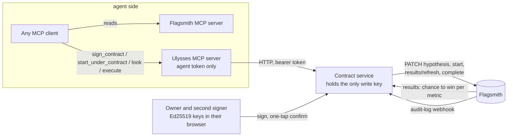

# When is a Flagsmith winner really a winner?

Flagsmith's statistics glossary calls a variation Winning when its chance to beat control is over 95%, and says you can check as often as you like. The dashboard goes further: its "Winning variation" card names whichever variant leads as soon as there is enough data, with no threshold at all. If you ship the first time the chance passes 95%, you will ship a lot of variations that do nothing. We ran Flagsmith's own statistics code on 2,000 simulated A/A experiments (two identical arms) with 30 looks each: stopping at the first look over 95% or under 5% called a winner or loser in 45% of them.

Ulysses keeps Flagsmith's number and adds a decision rule you sign before the data arrives. The owner signs a stop contract for the experiment: the horizon, the number of looks, an O'Brien-Fleming boundary for each look, and what happens on a win, a loss, no decision, or a guardrail breach. An agent then refreshes Flagsmith's results on schedule and can complete the experiment and ship the winner only when the contract fires, after one tap from the owner. On the same A/A experiments the contract made a false call in 4.9% of them.

It is an MCP extension (four tools), a small contract service that holds the only Flagsmith write key, a signing page and decision cards, and a calibration harness that reproduces the numbers on Flagsmith's own engine.

## Quick start

You need `uv` and a Flagsmith with Experimentation (Cloud, or self-hosted with `EXPERIMENTATION_ENABLED=true`).

```sh
git clone https://github.com/Dakshhhhh-ops/ulysses && cd ulysses
uv run ulysses init --flagsmith-url http://localhost:8000   # writes .env, a contract template, MCP client config
# put your organisation admin API key in .env (FLAGSMITH_ADMIN_KEY, FLAGSMITH_ORGANISATION_ID)
uv run ulysses lab setup                                    # demo flag, metrics, audit webhook
uv run python scripts/demo_setup.py                         # a fresh experiment and two signers (maya, sam)
uv run ulysses serve                                        # contract service on http://127.0.0.1:8200
uv run python scripts/agent_session.py --with-traffic       # in a second terminal
```

`agent_session.py` is a scripted agent with no LLM: it starts the Ulysses MCP server over stdio, calls the four tools in order, and does the two human steps with the owner's key file (pass `--wait-for-human` to sign and confirm in the browser instead). `--with-traffic` starts the demo shop and its simulated visitors. Because Flagsmith refreshes results at most every five minutes, a run takes 15 to 35 minutes.

Unit tests need nothing running: `uv run pytest -q`. The integration test against a live Flagsmith: `ULYSSES_LIVE=1 uv run pytest tests/test_live_flagsmith.py -q`.

To use it from your own agent, paste `ulysses.mcp.json` (written by `ulysses init`) into your MCP client next to Flagsmith's official MCP server. The package is published under the name `flagsmith-ulysses` (the name `ulysses` is taken on PyPI), so once released the install is `uvx --from flagsmith-ulysses ulysses init`; the command stays `ulysses`.

## How it works



1. `sign_contract` reads the experiment from Flagsmith, sizes the horizon from the baseline and the smallest lift the owner cares about, drafts the contract and returns a signing link. The contract is a TOML file; its id is the SHA-256 of its canonical JSON form, so reformatting does not change it and any edited value does.
2. The owner reads the contract and signs it. The key is created in their browser by WebCrypto as non-extractable, or kept in a key file for the `ulysses sign` command. The service checks the Ed25519 signature against the signer it registered.
3. `start_under_contract` is refused until that signature verifies. Then the service writes the contract hash into the experiment's hypothesis in Flagsmith and starts the experiment.
4. `look` asks Flagsmith to refresh the results (respecting the five-minute floor), reads Flagsmith's chance to win, turns it back into Flagsmith's own `lift / SE` with an inverse normal, and compares that with the signed boundary for this look. Guardrails are checked on the same read.
5. When a look fires, the service creates a proposal holding exactly the action the contract assigns to that outcome. `execute` is refused until the owner confirms with a signed tap, and refused outright for any other action. Then the service calls Flagsmith's `complete` with `rollout_decision`, which completes the experiment and serves the winning variation (or control) to everyone on the same flag in one call.
6. Changing a signed contract (ship early, extend the horizon, swap the metric) is an amendment: it needs the owner and the second signer, and it is appended to the experiment's hypothesis. Flagsmith's audit-log webhook tells the service about lifecycle changes it did not make; each becomes a recorded deviation, also written on the experiment.

The statistics, what the contract guarantees and what it does not, are in [docs/STATISTICS.md](docs/STATISTICS.md).

## Use of Flagsmith

Flagsmith does the assignment, the measurement, the inference and the rollout. Ulysses does not compute a single result: the card's number is Flagsmith's chance to win from `GET /experiments/<id>/results/`, and the only arithmetic Ulysses adds is the boundary it is compared with.

| Flagsmith feature | Where Ulysses uses it |
|---|---|
| Experiments REST API: `start`, `results/refresh`, `complete` with `rollout_decision` | The three lifecycle calls, made only by the contract service. Flagsmith keeps them out of its MCP server on purpose; Ulysses puts a signed contract in front of them. |
| Results endpoint and `chance_to_win` | The input to every look. |
| Experiment `hypothesis` field | Shows the governing contract hash, every amendment, deviations and the executed outcome inside Flagsmith's own UI. Written with `PATCH` on the experiment endpoint. The official MCP server's `update_experiment` tool targets the same endpoint but sends `PUT`, which this Flagsmith build rejects (400 without `feature`, 400 with it), so Ulysses uses `PATCH`; the bug is in our upstream draft. |
| Guardrail metrics (`not_increase` / `not_decrease`) | Checked on every look; a breach stops and keeps control. |
| Exposures timeseries | The horizon helper's exposure rate. |
| Organisation audit-log webhook (`AUDIT_LOG_CREATED`, `X-Flagsmith-Signature`) | Deviation detection and the audit replay. |
| Official Python SDK (`get_experiment_flag`, `track_event`, local evaluation) | The demo shop and the live calibration traffic. |
| `api/experimentation/stats.py` | The offline calibration loads Flagsmith's file unmodified, pinned by SHA-256. |
| Official MCP server | Reads for the agent (`get_experiment`, `get_experiment_results`, `get_experiment_exposures`), alongside the four Ulysses tools. By design it has no start, refresh or complete tool. |
| CLI v2 | Has no experiment commands, only the raw `flagsmith api` passthrough; useful to check the shipped flag (`flagsmith flag get`). Ulysses calls the REST API directly. |

## Impact

The cost Ulysses removes is a shipped variation that does nothing, or does harm, because someone acted on an early 95%. The calibration below measures how often that happens on Flagsmith's own engine, and how often it happens under a contract.

### Offline: Flagsmith's stats.py on simulated A/A experiments

Produced by `uv run ulysses calibrate offline` (`.run/calibration/offline.md`). Simulated synthetic units, not user traffic.

<!-- offline-table:start -->
Flagsmith `stats.py` (v2.295.2, sha256 `97c5ebfca7c8`) on 2000 simulated A/A experiments, 30 looks of 100 synthetic identities per arm, base rate 10%, seed 62944. Simulated units, not user traffic. Rates with 95% Wilson intervals.

| Rule (A/A, no real difference) | False Winning | False Losing | Any false call |
|---|---|---|---|
| Act at the first look over 95% or under 5% | 14.1% (12.6-15.6) | 30.9% (29.0-33.0) | 45.0% (42.8-47.2) |
| Read once, at the final look | 4.6% (3.8-5.6) | 4.7% (3.9-5.7) | 9.3% (8.1-10.7) |
| Ulysses contract, alpha 0.05 two-sided | 1.4% (0.9-2.0) | 3.5% (2.8-4.5) | 4.9% (4.0-5.9) |
| Ulysses contract, alpha 0.1 two-sided | 3.5% (2.7-4.3) | 6.0% (5.0-7.1) | 9.4% (8.2-10.8) |

Same engine and design with a true relative lift of +25% (10% to 12.5%), 2000 runs:

| Rule (real effect) | Calls the win | Mean look of the first call | Wrong-way call |
|---|---|---|---|
| Act at the first look over 95% or under 5% | 91.0% (89.6-92.1) | 9.58 | 5.3% (4.4-6.4) |
| Ulysses contract, alpha 0.05 | 80.2% (78.4-81.9) | 21.68 of 30 | 0.0% (0.0-0.2) |
| Ulysses contract, alpha 0.1 | 88.0% (86.5-89.4) | 19.75 of 30 | 0.0% (0.0-0.2) |
<!-- offline-table:end -->

The contract waits longer than the 95% rule (it calls a real +25% lift at look 22 of 30 on average, against look 10) and catches it less often at alpha 0.05. That is the price of the guarantee. At alpha 0.10, which allows the same 5% false-win rate a single read at 95% implies, it catches 88% of real lifts and never called one the wrong way in these runs; stopping at the first 95% called 5.3% of them the wrong way.

Under the contract, false Losing (3.5%) runs above false Winning (1.4%). That comes from Flagsmith's delta-method z on relative lift, which is skewed at these counts; the expensive error, shipping a variation that does nothing, stays under half of alpha. See docs/STATISTICS.md.

### Live: A/A experiments on self-hosted Flagsmith

Produced by `uv run ulysses calibrate live`, recomputed from the captured trace by `uv run ulysses calibrate summarise`. Every number is read from Flagsmith's results endpoint. The identities are synthetic, assigned by Flagsmith's engine through the Python SDK; they are not user traffic.

<!-- live-table:start -->
Live engine calibration on self-hosted Flagsmith (batch `d11c7f`): 60 A/A experiments, every number read from Flagsmith's results endpoint; 8 looks at least five minutes apart; at least 100 synthetic identities per arm per look, assigned by Flagsmith's engine (Python SDK, local evaluation); conversion probability 10% in both arms. 0 of 480 reads did not return in time and count as looks not taken. Synthetic identities, not user traffic. 95% Wilson intervals.

| Rule (A/A, no real difference) | False Winning | False Losing | Any false call |
|---|---|---|---|
| Act at the first look over 95% or under 5% | 4/60 = 6.7% (3-16) | 9/60 = 15.0% (8-26) | 13/60 = 21.7% (13-34) |
| Read once, at the final look | 1/60 = 1.7% (0-9) | 3/60 = 5.0% (2-14) | 4/60 = 6.7% (3-16) |
| Ulysses contract, alpha 0.05 two-sided | 0/60 = 0.0% (0-6) | 3/60 = 5.0% (2-14) | 3/60 = 5.0% (2-14) |

The contract reached the horizon with no decision in 23 of 60; in the other 34, Flagsmith had counted fewer than 800 identities in one arm by the last look (exposures still arriving or quarantined), so they were still holding when the run ended.

A smaller, noisier sample than the offline run, read from a real Flagsmith. It shows the same pattern: one in five A/A experiments would have been called at the first 95%, the contract called 3 of 60, all as losses (keep control). Under load the SDK dropped some event batches after three timed-out tries, so Flagsmith's counts trailed the identities sent by about 56 per arm at the last look; the table uses Flagsmith's counts throughout. A first, larger batch was cut short when the shared lab restarted and is not reported.
<!-- live-table:end -->

### The demo experiment

One run of `scripts/agent_session.py --with-traffic` against the self-hosted lab. Traffic: simulated visitors from `examples/shop/visitors.py` opening the demo shop, which asks Flagsmith for the variation with `get_experiment_flag` and reports purchases with `track_event`. The visitors are synthetic and their behaviour is drawn by the script (purchase probability 10% after seeing classic, 17% after seeing bold); every number below was read from Flagsmith's results endpoint by the service. Contract: 6 looks, horizon 1,066 identities per arm, alpha 0.05.

| Look | Identities per arm (Flagsmith) | Flagsmith chance to win | Contract needs | Card |
|---|---|---|---|---|
| 1 | 201 | 86.91% | 99.99998% | HOLD |
| 2 | 429 | 99.48% | 99.959% | HOLD, though a 95% reader would have shipped |
| 3 | 668 | 99.94% | 99.55% | WIN |

The agent then asked to execute before the owner confirmed (refused, 403), asked for `keep_control` (refused, 403: the contract assigns `ship_treatment` to a win), and after maya's signed tap the service called `complete` with `rollout_decision: variant`. Flagsmith's experiment shows `completed`, `rollout_decision: variant`, the contract hash and the outcome in its hypothesis, and a brand-new identity is served `bold`. `ulysses audit replay` maps both lifecycle changes (start and completion) to the signed contract, with no deviations.

An earlier run of the same script on the same design held through four looks while Flagsmith's number sat between 97.7% and 98.9% (over 95% each time), and fired the win at the horizon with 99.71% against a boundary of 97.89%.

## Creativity

Most agent integrations ask a human to approve an action after the agent proposes it. Ulysses moves the approval to before any data exists, when nobody has a result to be excited about, and makes the later approval a one-tap confirmation of something already decided. The contract is a hashed, signed file whose hash lives on the experiment in Flagsmith, so anyone looking at the experiment can see which rule governs it. The agent cannot ship early because the service will not let it; a person can still press Complete in the dashboard, and that shows up on the experiment as a deviation.

## Demo video

The video follows one experiment: the owner signs the contract, the hash appears on the experiment in Flagsmith, Flagsmith puts the chance to win above 95% (and its winner card already names bold) while the Ulysses card says hold, the contract fires, one tap ships the variation on the same flag, and the A/A count closes it. The statistics stay in this README.

## Track 02 checklist

| Requirement | How Ulysses meets it |
|---|---|
| Uses the Flagsmith CLI, API or MCP server | REST API for the lifecycle and results, the official MCP server for agent reads, the official SDK in the demo app. The Ulysses MCP server adds four tools. CLI v2 has no experiment command, so it is only used to check the shipped flag (`flagsmith flag get`). |
| Saves real time | Nobody refreshes the results page every five minutes; looks run on schedule and the pre-signed action runs on one tap. The bigger saving is not shipping a variation that does nothing. Honest cost: a contract often waits longer than stopping at the first 95% would. |
| A human approves changes | Twice: the owner signs before start (start is refused without it), and confirms the fired action with a signed tap. Amendments need a second signer. |
| Clear output | One card per look: Flagsmith's chance to win, what the contract needs at this look, hold or fire, and the pre-signed action. |

## Commands

```
ulysses serve                      contract service (port 8200)
ulysses mcp                        the MCP extension over stdio
ulysses keys new <name>            create a signing key file
ulysses signer enrol <name>        one-time link that creates a key in the signer's browser
ulysses contract verify <file>     validate a contract and print its hash and boundary
ulysses sign <hash> --as <name>    sign with your key file
ulysses look <hash> / watch <hash> one look / look on schedule until it fires
ulysses confirm <look id> --as <name>
ulysses amend <hash> --reason ... [--action-now ship_treatment]
ulysses horizon --min-lift 0.1 --baseline-rate 0.05 [--rate-per-hour 120]
ulysses boundary --looks 12
ulysses audit replay --project <id>
ulysses calibrate offline | live | summarise
```

## Limitations

- Ulysses binds the agent. It cannot stop someone with dashboard rights from completing an experiment or editing its flag (Flagsmith does not lock the flag through the API while an experiment runs). Through the audit-log webhook it detects, and writes on the experiment, any start, pause, completion, rollout change, deletion or hypothesis edit on a governed experiment that the service did not make itself. It does not currently flag direct edits to the flag's values or weights (they arrive as feature-state entries), and someone with dashboard rights can edit the hypothesis afterwards; the service's own log and the replay still hold the record. If Flagsmith is unreachable when a deviation arrives, the deviation is recorded by the service but the line on the experiment is not written; there is no retry for that write yet.
- On open-source Flagsmith every key that can read experiments can also write them, so giving the agent the official MCP server means giving it an admin key. The `look` tool already returns Flagsmith's numbers; in production we would leave the official server out, or use a read-only role on Enterprise.
- The audit-log list API returns nothing on an unlicensed self-hosted instance, so the replay works from the entries Flagsmith's webhook delivered to the service. Entries from before the webhook was registered are not covered.
- The offline numbers are simulations on synthetic units. The live numbers come from Flagsmith's results endpoint but with synthetic identities whose behaviour this repository draws. Neither is user traffic.
- The guarantee is asymptotic and covers one treatment against control on one primary metric. Details in docs/STATISTICS.md.
- Flagsmith's SDK retries event batches on a 3-second timeout and can store a batch twice. That cannot change exposures or Occurrence metrics, which the demo and calibration use, but it can inflate Count, Sum and Mean metrics.

## Related work

GrowthBook offers sequential testing as an engine feature (confidence sequences, paid plans). `harshit3355/rollouts-plugin-metric-sequential` applies an anytime-valid test to Argo Rollouts canaries. Neither works with Flagsmith or binds an agent to a pre-signed rule. Evan Miller's "How Not To Run an A/B Test" is the classic account of the peeking problem.

## Upstream

A docs issue for Flagsmith is drafted in [upstream/flagsmith-docs-peeking.md](upstream/flagsmith-docs-peeking.md). It proposes wording that keeps the glossary's point about the posterior and adds the condition under which peeking is safe.

## License

MIT
