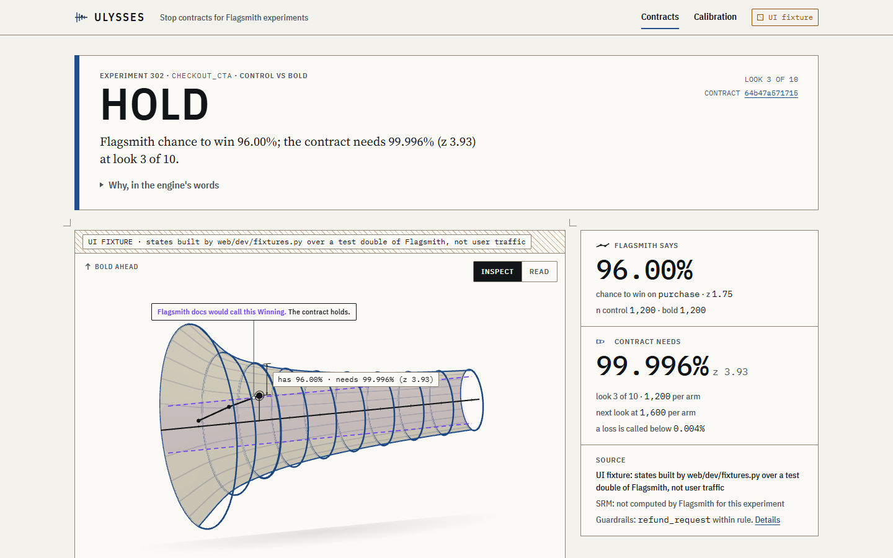
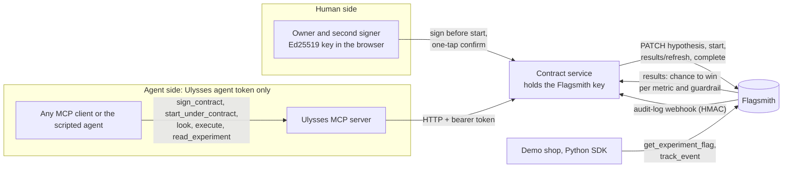
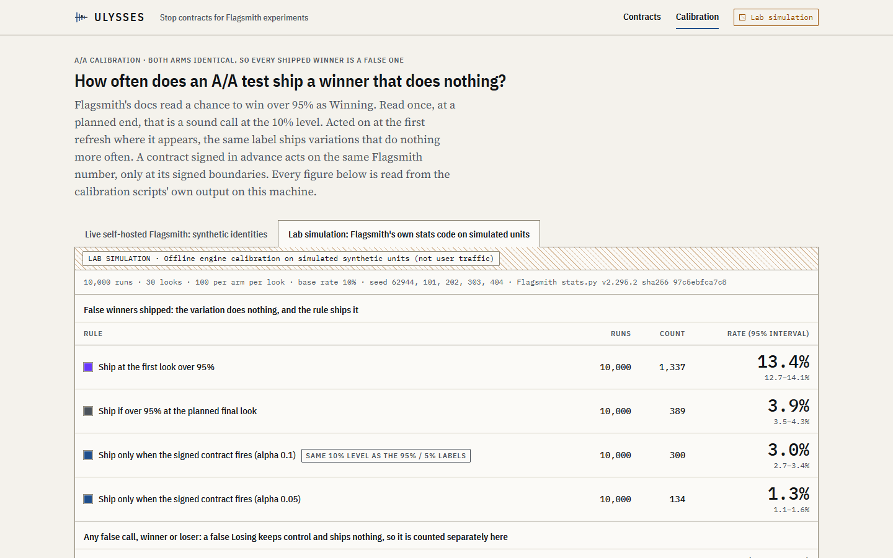

# When is a Flagsmith winner really a winner?

Ulysses lets the owner of a Flagsmith experiment sign the stop rule before any data exists. An agent then watches the experiment and can complete it and ship the winner only when that signed rule fires, not at the first look where Flagsmith's chance to win passes 95%.

Flagsmith's chance to beat control is a fair summary of the evidence each time you read it. The trouble starts when "over 95%" becomes the moment to ship and someone, or an agent, checks every five minutes. Ulysses keeps Flagsmith's number exactly as it is and adds the rule that makes acting on it safe.

How often a variation that does nothing gets shipped, measured on Flagsmith's own `stats.py` (offline simulation by `uv run ulysses calibrate offline`: 10,000 A/A experiments, 30 looks of 100 synthetic identities per arm, base rate 10%; simulated units, not user traffic):

<!-- headline-table:start -->
| Rule | Error level it is meant to have | Ships a do-nothing variation |
|---|---|---|
| Stop at the first look over 95% | 10% two-sided, read 30 times | 13.4% (12.7-14.1) |
| Read once at the end, ship if over 95% | 10% two-sided | 3.9% (3.5-4.3) |
| Ulysses contract, alpha 0.10 (same level as the 95% rule) | 10% two-sided | 3.0% (2.7-3.4) |
| Ulysses contract, alpha 0.05 (the default) | 5% two-sided | 1.3% (1.1-1.6) |

Counting false losers as well (a false Losing call keeps control, so it ships nothing), any-direction false calls were 44.7% for the first look over 95% or under 5%, 9.8% for a single read at the end, 10.1% for the contract at alpha 0.10 and 5.3% at alpha 0.05. Ranges are 95% Wilson intervals; full tables are under [Impact](#impact).
<!-- headline-table:end -->



The card above is the whole idea. Flagsmith's docs would call this variation Winning; the contract signed before the start needs 99.996% at look 3 of 10, so it holds. (This screenshot is a UI fixture, as its amber chip says: the page rendered over a test double of Flagsmith, not live traffic. The demo below produces the same cards from a real Flagsmith.)

What makes this different from an agent that asks "may I ship?": the approval that matters comes before the experiment starts, when nobody has a result to be excited about. The owner signs the horizon, the number of looks, the boundary at each look and the action for each outcome. Later, when the contract fires, the owner confirms with one tap, and that tap can only confirm the action already signed. The service holds the Flagsmith key; the agent holds only a Ulysses token, with no Flagsmith key and no signing key, so through Ulysses it cannot start an unsigned experiment, ship early, or ship the other arm. That holds as long as the service, its `.env` and the signer keys sit where the agent's process cannot read them (see [Limitations](#limitations)).

## Try it: one command

You need Docker and [uv](https://docs.astral.sh/uv/). Nothing else, no Flagsmith account.

macOS or Linux:

```sh
git clone https://github.com/Dakshhhhh-ops/ulysses && cd ulysses && uv run python scripts/judge_demo.py
```

Windows PowerShell:

```powershell
git clone https://github.com/Dakshhhhh-ops/ulysses; cd ulysses; uv run python scripts/judge_demo.py
```

What that command does, in order:

1. Starts a stock open-source Flagsmith 2.295.2, pinned by digest, with `EXPERIMENTATION_ENABLED=true` (`docker-compose.yml`, compose project `ulysses`, dashboard on http://localhost:8280). No Flagsmith code is changed.
2. Signs up the first user on that fresh instance, creates an organisation and an organisation admin API key, and writes them to `.run/judge.env` (git-ignored) with a new agent token and webhook secret.
3. Creates the demo flags, a purchase metric and a refund-request guardrail, and the signed audit-log webhook (`ulysses lab setup`). Then two experiments: an A/A experiment on `ulysses_headline_aa`, whose two variations show the same headline, and a real-effect experiment on `ulysses_checkout_cta` (classic against bold). It also creates two signers, owner `maya` and second signer `sam`, with passphrase-encrypted key files in your user profile, outside the project folder.
4. Starts the contract service (the process that holds the Flagsmith key), the demo shop and its simulated visitors, a stand-in for the owner's browser taps (a separate process holding maya's key), and the scripted agent, which gets only the Ulysses agent token.
5. Prints every look for both experiments, with each guardrail's reading, and at the end a summary of what shipped, how many looks it took and how many five-minute checks nobody had to make.

Flagsmith refreshes results at most every five minutes, so a run takes a while. From a fresh clone on a Windows laptop, with the Flagsmith image already downloaded, the command finished in 32.4 minutes (its own summary said 32.2); a first run also downloads the image. Afterwards, `uv run python scripts/judge_demo.py --serve-only` serves the decision cards again, and `docker compose -p ulysses down -v` removes Flagsmith and its data.

Port already taken? `--flagsmith-port`, `--port` (contract service, default 8240) and `--shop-port` (default 8241) move them. If you already run a Flagsmith with Experimentation on, `--flagsmith http://your-host:port` uses it instead of starting one (the bootstrap step creates a first user, so point it only at a throwaway instance).

To sign and confirm yourself instead of the stand-in, run the pieces by hand (next section) and open the links the agent prints.

## Set it up against your own Flagsmith

Self-hosted Flagsmith needs `EXPERIMENTATION_ENABLED=true`, and `SSRF_ALLOWED_HOSTS=host.docker.internal` if Flagsmith runs in Docker and the contract service runs on the host (Flagsmith refuses webhooks to private addresses otherwise). Tested on self-hosted 2.295.2 only. Flagsmith Cloud is untested, and its webhook would need a public URL for the service.

```sh
uv run ulysses init --flagsmith-url http://localhost:8000
```

`init` writes `.env` with a fresh agent token and webhook secret, a contract template, and `ulysses.mcp.json` for your MCP client. Both `.env` and `ulysses.mcp.json` are added to `.gitignore`, because both hold the agent token. Put an organisation admin API key and the organisation id in `.env`: in the Flagsmith dashboard, Organisation settings, API Keys, create a key with admin rights; the organisation id is the number in that page's URL.

```sh
uv run ulysses lab setup                       # demo flags, metrics, signed audit webhook (--no-webhook to skip)
uv run python scripts/demo_setup.py            # the A/A and real-effect experiments, signers maya and sam
uv run ulysses serve                           # contract service on http://127.0.0.1:8200
uv run python scripts/agent_session.py --with-traffic      # second terminal: the scripted agent
```

`demo_setup.py` lists every experiment it will clear on the two demo flags before it touches any of them. It deletes an experiment that has not started, refuses to end a running one unless you pass `--replace`, and never ends one a Ulysses contract governs.

The agent session prints a signing link and waits. Open it in a browser and sign (the first visit on a new browser uses an enrolment link from `uv run ulysses signer enrol maya`), or run the stand-in in a third terminal: `uv run python scripts/human_stand_in.py --owner maya`. If the session stops, `--resume <hash>,<hash>` continues the same contracts, and `uv run ulysses watch <hash>` looks on schedule from the command line. Both retry 429, 502, 503 and timeouts with backoff and say so in one line.

Tests need nothing running: `uv run pytest -q`. The integration test against a live Flagsmith:

```sh
ULYSSES_LIVE=1 uv run pytest tests/test_live_flagsmith.py -q          # macOS / Linux
```

```powershell
$env:ULYSSES_LIVE=1; uv run pytest tests/test_live_flagsmith.py -q   # Windows PowerShell
```

The package's distribution name is `flagsmith-ulysses` (`ulysses` is taken on PyPI). It is not on PyPI; install from the repository: `uvx --from git+https://github.com/Dakshhhhh-ops/ulysses ulysses init`.

## How it works



1. `sign_contract` reads the experiment from Flagsmith, sizes the horizon from the baseline rate and the smallest lift the owner cares about, drafts the contract and returns a signing link. The contract is TOML; its id is the SHA-256 of its canonical JSON form, so reformatting does not change it and any edited value does.
2. The owner reads the contract and signs it. In the browser the key is created by WebCrypto as non-extractable; the `ulysses sign` command uses an encrypted key file instead. The service checks the Ed25519 signature against the key it registered for that signer.
3. `start_under_contract` is refused until the signature verifies. Then the service writes the contract hash into the experiment's hypothesis in Flagsmith and starts the experiment.
4. `look` asks Flagsmith to refresh the results (respecting the five-minute floor), reads Flagsmith's chance to win, turns it back into Flagsmith's own `lift / SE`, and compares that with the signed boundary for this look. Each guardrail gets the same treatment against its own one-sided signed rule. By default a win cannot fire while a guardrail has no Flagsmith result yet (Flagsmith needs 5 conversions per arm before it reports one).
5. When a look fires, the service creates a proposal holding exactly the action the contract assigns to that outcome. `execute` is refused until the owner confirms with a signed tap, and refused outright for any other action. Then the service calls Flagsmith's `complete` with `rollout_decision`, which ends the experiment and serves the winner (or control) to everyone on the same flag.
6. Changing a signed contract (ship early, extend the horizon, swap the metric) is an amendment. It needs the owner and the second signer and is appended to the experiment's hypothesis. Lifecycle changes the service did not make, seen through the audit-log webhook or at the next look, are recorded as deviations and written on the experiment.

The statistics, and what the contract does and does not guarantee, are in [docs/STATISTICS.md](docs/STATISTICS.md).

## Use of Flagsmith

Flagsmith does the assignment, the measurement, the inference and the rollout. Ulysses computes no result of its own: the number on every card is Flagsmith's chance to win from `GET /experiments/<id>/results/`, and the only arithmetic Ulysses adds is the boundary it is compared with.

| Flagsmith feature | Where Ulysses uses it |
|---|---|
| Experiments REST API: `start`, `results/refresh`, `complete` with `rollout_decision` | The lifecycle calls, made only by the contract service, only under a signed contract. |
| Results endpoint, `chance_to_win` and lift per metric | The input to every look, for the primary metric and each guardrail. |
| Guardrail metrics (`not_increase` / `not_decrease`) | Each look reads Flagsmith's chance that the guardrail got worse; a breach of the signed rule stops and keeps control. |
| Experiment `hypothesis` field | Carries the governing contract hash, amendments, deviations and the executed outcome, so they show inside Flagsmith's own UI. |
| Organisation audit-log webhook with `X-Flagsmith-Signature` | Deviation detection and `ulysses audit replay`. The service refuses unsigned deliveries. |
| Exposures timeseries | The horizon helper's exposure rate. |
| Official Python SDK (`get_experiment_flag`, `track_event`, local evaluation) | The demo shop and the live calibration traffic. |
| `api/experimentation/stats.py` | The offline calibration loads Flagsmith's file unmodified, pinned by SHA-256. |
| Self-hosting with Docker | The one-command demo runs a stock, pinned image. |

The official Flagsmith MCP server is not configured for the agent; the reasons are under [Limitations](#limitations). The agent reads experiments through the Ulysses `read_experiment` tool, which calls the service's `GET /api/flagsmith/experiments/{env}/{id}`: GET only, and it never returns a key.

## Impact

The cost Ulysses removes is a shipped variation that does nothing, or does harm, because someone acted on an early 95%. The tables below measure how often that happens on Flagsmith's own engine, and how often under a contract. Every figure comes from a script in this repository, and each table says what produced it.

### Offline: Flagsmith's stats.py on simulated A/A experiments

Produced by `uv run ulysses calibrate offline` (writes `.run/calibration/offline.md`). Simulated synthetic units, not user traffic.

<!-- offline-table:start -->
Flagsmith `stats.py` (v2.295.2, sha256 `97c5ebfca7c8`) on 10000 simulated A/A experiments (5 seeds pooled: 62944, 101, 202, 303, 404), 30 looks of 100 synthetic identities per arm, base rate 10%. Simulated units, not user traffic. 95% Wilson intervals.

False ships: how often a variation that does nothing would be shipped.

| Rule | Level | Ships a do-nothing variation (false Winning) |
|---|---|---|
| Read once at the final look (95%/5%) | 10% two-sided | 3.9% (3.5-4.3) |
| Stop at the first look over 95% or under 5% | 10% two-sided, read 30 times | 13.4% (12.7-14.1) |
| Ulysses contract, alpha 0.10 | 10% two-sided | 3.0% (2.7-3.4) |
| Ulysses contract, alpha 0.05 (default) | 5% two-sided | 1.3% (1.1-1.6) |

Any false call, counting false Losing too (a false Losing keeps control, so it ships nothing):

| Rule | False Winning | False Losing | Any false call |
|---|---|---|---|
| Read once at the final look | 3.9% (3.5-4.3) | 5.9% (5.5-6.4) | 9.8% (9.3-10.4) |
| Stop at the first look over 95% or under 5% | 13.4% (12.7-14.1) | 31.3% (30.4-32.2) | 44.7% (43.7-45.6) |
| Ulysses contract, alpha 0.10 | 3.0% (2.7-3.4) | 7.1% (6.6-7.6) | 10.1% (9.5-10.7) |
| Ulysses contract, alpha 0.05 | 1.3% (1.1-1.6) | 4.0% (3.6-4.4) | 5.3% (4.9-5.8) |

Same design with a true relative lift of +25% (10% to 12.5%), 10000 runs:

| Rule | Calls the win | Wrong-way call | Mean look of the first call | Mean identities per arm used (all runs) |
|---|---|---|---|---|
| Stop at the first look over 95% or under 5% | 91.0% (90.4-91.5) | 5.0% (4.6-5.4) | 9.62 | 1044.5 |
| Ulysses contract, alpha 0.10 | 88.4% (87.7-89.0) | 0.0% (0.0-0.0) | 19.93 | 2110.1 |
| Ulysses contract, alpha 0.05 | 79.3% (78.5-80.1) | 0.0% (0.0-0.0) | 21.81 | 2350.2 |

Against a fixed-horizon test with the same false-ship level and the same power (79.3%): that test needs 2858 identities per arm (the contract's horizon 3000 divided by the sequential inflation 1.0497). The contract at alpha 0.05 used 2350.2 on average, 17.8% fewer.

Design sensitivity, contract at alpha 0.05, A/A (the guarantee holds for false Winning; false Losing runs over its nominal 2.5% when conversions are few):

| Base rate | Identities per arm per look x looks | Expected conversions per arm at the horizon | False Winning | False Losing |
|---|---|---|---|---|
| 2% | 100 x 30 | 60 | 0.1% (0.1-0.4) | 5.6% (4.7-6.7) |
| 5% | 100 x 30 | 150 | 0.8% (0.5-1.3) | 5.9% (4.9-7.0) |
| 10% | 100 x 30 | 300 | 1.6% (1.1-2.2) | 4.0% (3.2-5.0) |
| 2% | 605 x 30 | 363 | 1.2% (0.8-1.8) | 3.6% (2.9-4.6) |

Guardrails in A/A (a guardrail metric at 10% in both arms, no effect), share of experiments stopped for a guardrail breach that is not there:

| Guardrail direction | Old rule: 97.5% chance worse at any look | Signed rule: one-sided Pocock-type spending, alpha 0.01, counted looks |
|---|---|---|
| not increase | 6.0% (5.6-6.5) | 0.1% (0.1-0.2) |
| not decrease | 22.0% (21.2-22.9) | 4.4% (4.0-4.8) |
<!-- offline-table:end -->

### Live: A/A experiments on self-hosted Flagsmith

Produced by `uv run ulysses calibrate live` and recomputed from its trace by `uv run ulysses calibrate summarise <trace>`. Every number is read from Flagsmith's results endpoint. The identities are synthetic, assigned by Flagsmith's engine through the Python SDK; they are not user traffic.

<!-- live-table:start -->
Live engine calibration on self-hosted Flagsmith (batch `72e1bc`): 30 A/A experiments, every number read from Flagsmith's results endpoint. Signed design: 6 looks at least five minutes apart, horizon 600 identities per arm, contract alpha 0.05. At least 100 synthetic identities per arm were sent per look, assigned by Flagsmith's engine (Python SDK, local evaluation), conversion probability 10% in both arms. Synthetic identities, not user traffic. 95% Wilson intervals.

| Rule (A/A, no real difference) | False Winning (ships a do-nothing variation) | False Losing | Any false call |
|---|---|---|---|
| Stop at the first look over 95% or under 5% (looks 1-6) | 0/30 = 0.0% (0-11) | 1/30 = 3.3% (1-17) | 1/30 = 3.3% (1-17) |
| Read once at the final look | 0/30 = 0.0% (0-11) | 1/30 = 3.3% (1-17) | 1/30 = 3.3% (1-17) |
| Ulysses contract, alpha 0.05 two-sided | 0/30 = 0.0% (0-11) | 1/30 = 3.3% (1-17) | 1/30 = 3.3% (1-17) |

Contract outcomes: 0 wins, 1 losses, 29 at the horizon with no decision, 0 still holding.

Every experiment in this batch reached its horizon, Flagsmith counted exactly the identities sent, and no read was missed. At 30 experiments and 6 looks the batch cannot tell the rules apart: each made one false call (a loss), none shipped a do-nothing variation, and the intervals are wide (0-11% for false Winning). It shows the whole pipeline working on Flagsmith's own results endpoint, and that the contract made no false ship there. It does not show the cost of peeking; the 10,000-run offline table carries that claim.

An earlier, larger batch, `d11c7f`, scored under the design it was started with (it stopped at look 8 of 10 on a Flagsmith 429):

Live engine calibration on self-hosted Flagsmith (batch `d11c7f`): 60 A/A experiments, every number read from Flagsmith's results endpoint. Signed design: 10 looks at least five minutes apart, horizon 1000 identities per arm, contract alpha 0.05. At least 100 synthetic identities per arm were sent per look, assigned by Flagsmith's engine (Python SDK, local evaluation), conversion probability 10% in both arms. Synthetic identities, not user traffic. 95% Wilson intervals. The run stopped after look 8 of 10 (see the batch notes); the table covers the looks that were read, and the contract is scored under its signed design without re-fitting.

| Rule (A/A, no real difference) | False Winning (ships a do-nothing variation) | False Losing | Any false call |
|---|---|---|---|
| Stop at the first look over 95% or under 5% (looks 1-8) | 4/60 = 6.7% (3-16) | 9/60 = 15.0% (8-26) | 13/60 = 21.7% (13-34) |
| Ulysses contract, alpha 0.05 two-sided | 0/60 = 0.0% (0-6) | 2/60 = 3.3% (1-11) | 2/60 = 3.3% (1-11) |

Contract outcomes: 0 wins, 2 losses, 0 at the horizon with no decision, 58 still holding when the run stopped at look 8 of 10.

In that batch 58 of 60 contracts were still holding when the run stopped, so its contract row covers a truncated design; the 13 of 60 first-look calls are mostly false losses (9), and its false-Winning interval (3-16%) overlaps the nominal 5%.

The traces ship with timestamps removed, so the tables can be recomputed from a clone: `uv run ulysses calibrate summarise data/live-72e1bc.jsonl` and `uv run ulysses calibrate summarise data/live-d11c7f.jsonl` (each also writes a `live.md` next to the trace). A batch in between, `ab1aca`, lost events to an SDK buffer overflow and is not reported.
<!-- live-table:end -->

### Time saved

Against a fixed-horizon test with the same false-ship level and the same power, the contract at alpha 0.05 used 17.8% fewer identities on a real +25% lift (2,350 per arm on average against 2,858; offline simulation, `uv run ulysses calibrate offline`). The first-95% rule stops earlier still, and that early stop is exactly where its false winners come from.

In the demo run below (from `.run/agent-session-result.json`), the agent ran 5 results refreshes on schedule and reached a decision on the real-effect experiment after 4 counted looks, 21.1 minutes after the start; the A/A experiment took 6 refreshes, 5 counted looks and 26.2 minutes. Nobody refreshed a page or watched a number in that time. The saving per experiment is small in minutes; what it removes is the person deciding at each refresh whether 95% is enough.

### The demo run

One run of `uv run python scripts/judge_demo.py` from a fresh clone, against the stock Flagsmith that `docker-compose.yml` starts. Traffic: simulated visitors from `examples/shop/visitors.py` (90 a minute; purchase 10% after classic, 17% after bold; 30% of purchases ask for a refund in both arms). The visitors are synthetic; every number below was read from Flagsmith's results endpoint by the contract service. Both contracts: horizon 1,088 identities per arm, up to 30 looks, Lan-DeMets O'Brien-Fleming, alpha 0.05; guardrail `ulysses_refund_request` (not increase) under its own one-sided rule.

Real effect (`ulysses_checkout_cta`, classic against bold):

| Look | Identities per arm | Flagsmith chance to win | Contract needs | Refund guardrail: chance worse (stop rule) | Card |
|---|---|---|---|---|---|
| 1 | 224 | 95.21% | 99.9999% | 75.5% (99.70%) | HOLD, though the docs would call it Winning |
| 2 | 450 | 95.91% | 99.95% | 28.9% (99.70%) | HOLD, Winning by the docs |
| 3 | 674 | 97.48% | 99.58% | 56.8% (99.70%) | HOLD, Winning by the docs |
| 4 | 913 | 99.65% | 98.70% | 57.0% (99.69%) | WIN: ship bold |

A/A (`ulysses_headline_aa`, two identical variations):

| Look | Identities per arm | Flagsmith chance to win | Contract needs | Refund guardrail: chance worse (stop rule) | Card |
|---|---|---|---|---|---|
| 1 | 212 | 35.44% | 99.999962% | 44.7% (99.71%) | HOLD |
| 2 | 439 | 59.60% | 99.96% | 48.6% (99.70%) | HOLD |
| 3 | 653 | 46.88% | 99.63% | 55.6% (99.71%) | HOLD |
| 4 | 887 | 29.39% | 98.82% | 57.6% (99.69%) | HOLD |
| 5 | 1,123 | 31.35% | 97.91% | 59.3% (99.71%) | NO DECISION: keep control |

On the real-effect experiment the agent then asked to execute before the owner confirmed (refused, 403 "waiting for the owner's one-tap confirmation") and asked for `keep_control` (refused, 403: the contract authorises `ship_treatment` for a win). After the owner's signed tap the service called `complete` with `rollout_decision: variant`. In Flagsmith afterwards, experiment 1 is `completed` with `rollout_decision: variant` and experiment 2 `completed` with `rollout_decision: control`, and each hypothesis holds exactly two Ulysses lines: the governing contract and the executed outcome. `ulysses audit replay --project 1` reported 4 lifecycle changes on governed experiments, 4 mapped to a signed contract, 0 deviations.

The three holds on the real-effect experiment were on a real effect (a 70% relative lift; the horizon was sized for 50%), so there the contract waited three more looks, about 15 minutes, than someone shipping at the first 95% would have. That is the price of capping false ships. In this run the A/A experiment never went over 95%, as in most A/A runs (in the offline table, stopping at the first look over 95% shipped a do-nothing variation in 13.4% of them); when one does go over, the contract treats it like look 1 above and holds. The A/A experiment is where holding is plainly right: both arms show the same page, so any winner Flagsmith reports there is noise.

## Creativity

Most agent integrations put a human approval after the agent proposes an action, at the moment the human is looking at a promising number. Ulysses moves the real approval to before any data exists and turns the later one into a one-tap confirmation of something already decided. The contract is a hashed, signed file, and its hash lives on the experiment in Flagsmith, so anyone who opens the experiment can see which rule governs it. The calibration harness runs Flagsmith's own `stats.py`, unmodified and pinned by hash, so the claim about peeking is tested on the engine Flagsmith users actually get.

## Demo

The demo video shows both experiments side by side. On the A/A experiment, Flagsmith's chance to win wanders and the card holds, then reaches the horizon and keeps control. On the real-effect experiment the contract fires, the agent's early and wrong-action `execute` calls are refused on screen, the owner taps confirm, and Flagsmith serves bold to everyone. Every card shows the guardrail reading. Any judge can reproduce the same run with the one command above.


The confirm page, also a UI fixture over a test double of Flagsmith (amber chip, top right): the tap signs exactly the text shown, for exactly the pre-signed action.



## Track 02 checklist

| Requirement | How Ulysses meets it |
|---|---|
| Uses the Flagsmith CLI, API or MCP server | The REST API for the lifecycle and results, the official SDK in the demo shop, Flagsmith's own `stats.py` in the calibration. Ulysses ships its own MCP server (four action tools and one read tool) for agents. |
| Saves real time | Looks run on schedule, so nobody refreshes the results page; the pre-signed action runs on one tap. Against a fixed horizon with the same guarantee it used 17.8% fewer identities in simulation. Honest cost: the contract waits longer than the first-95% rule would. |
| A human approves changes | Twice: the owner signs before start (start is refused without it) and confirms the fired action with a signed tap. Amendments need a second signer. |
| Clear output | One card per look: Flagsmith's chance to win, what the contract needs at this look, each guardrail's reading against its rule, hold or fire, and the pre-signed action. |
| A working demo | `uv run python scripts/judge_demo.py` on a machine with Docker and uv. |

## Commands

```
ulysses init                       .env, contract template, MCP client config
ulysses serve                      contract service (port from ULYSSES_PUBLIC_URL, default 8200)
ulysses mcp                        the MCP extension over stdio
ulysses keys new <name>            create an encrypted signing key file
ulysses signer enrol <name>        one-time link that creates a key in the signer's browser
ulysses contract verify <file>     validate a contract and print its hash and boundary
ulysses sign <hash> --as <name>    sign with your key file
ulysses look <hash> / watch <hash> one look / look on schedule until it fires
ulysses confirm <look id> --as <name>
ulysses amend <hash> --reason ... [--action-now ship_treatment]
ulysses horizon --min-lift 0.1 --baseline-rate 0.05 [--rate-per-hour 120]
ulysses boundary --looks 12
ulysses audit replay --project <id>
ulysses calibrate offline | live | summarise
ulysses lab setup [--no-webhook]
```

Errors print one line and a next step. `ULYSSES_DEBUG=1` shows the traceback.

## Limitations

- Ulysses binds the agent, not a dashboard admin. Someone with dashboard rights can still complete an experiment or edit its flag; Flagsmith does not lock the flag while an experiment runs. Ulysses records that as a deviation (from the audit-log webhook, or at the next look when it compares the experiment with what it started) and writes it on the experiment, retrying the write if Flagsmith is down. It cannot prevent it.
- The boundary between agent and human is a process and key boundary. In the one-command demo the agent process gets only its token, and the signer keys sit encrypted in your user profile, but everything runs as one OS user on one machine. For real use, run the contract service, its `.env` and the signer keys where the agent cannot read them: another OS user, a container or another host. An agent that can read `.env` can call Flagsmith directly.
- The official Flagsmith MCP server is not given to the agent. On open-source Flagsmith there is no read-only key: every key that can read experiments can also write flags, so handing the agent that server would hand it a way around the contract. Its `update_experiment` tool also fails on 2.295.2 (it sends `PUT`, which the endpoint rejects with or without `feature`), so Ulysses writes the hypothesis with `PATCH`. Both are written up in `upstream/`. `ulysses init` leaves the server out; `--with-flagsmith-mcp` adds it, with a warning, for people who accept that trade.
- Offline numbers are simulations on synthetic units. Live numbers come from Flagsmith's results endpoint, but the identities are synthetic and their behaviour is drawn by scripts in this repository. Neither is user traffic, and every table says which it is.
- The audit-log list API returns nothing on an unlicensed self-hosted instance, so the replay works from the entries Flagsmith's webhook delivered. Entries from before the webhook was registered are not covered.
- The guarantee is asymptotic and covers one treatment against control on one primary metric. At low base rates and short horizons false Losing runs over its nominal share; the contract warns the signer when the design is in that range. Details in docs/STATISTICS.md.
- Flagsmith's SDK can store an event batch twice after a timeout. That cannot change exposures or Occurrence metrics, which the demo and calibration use, but it can inflate Count, Sum and Mean metrics.

## Related work

GrowthBook offers sequential testing as an engine feature (confidence sequences, paid plans). `harshit3355/rollouts-plugin-metric-sequential` applies an anytime-valid test to Argo Rollouts canaries. Neither works with Flagsmith or binds an agent to a pre-signed rule. Evan Miller's "How Not To Run an A/B Test" is the classic account of the peeking problem.

## Upstream

[upstream/flagsmith-docs-peeking.md](upstream/flagsmith-docs-peeking.md) holds two drafted issues for Flagsmith, not posted: suggested wording for the statistics glossary's note on peeking, and the MCP `update_experiment` PUT problem.

## License

MIT
