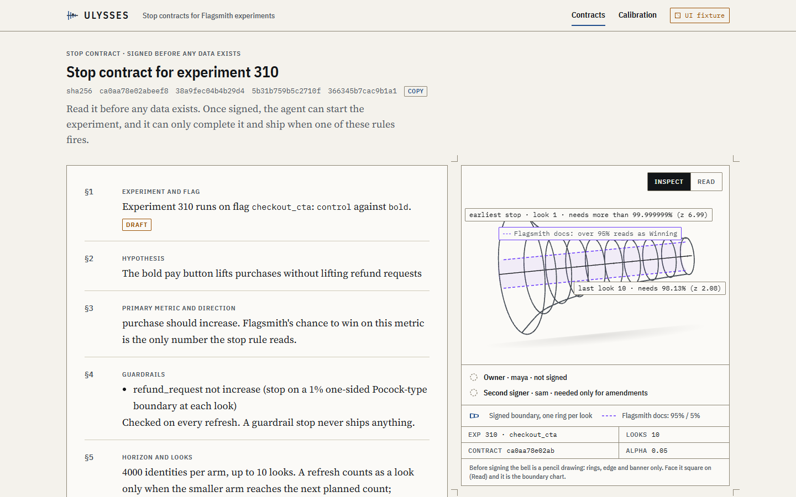
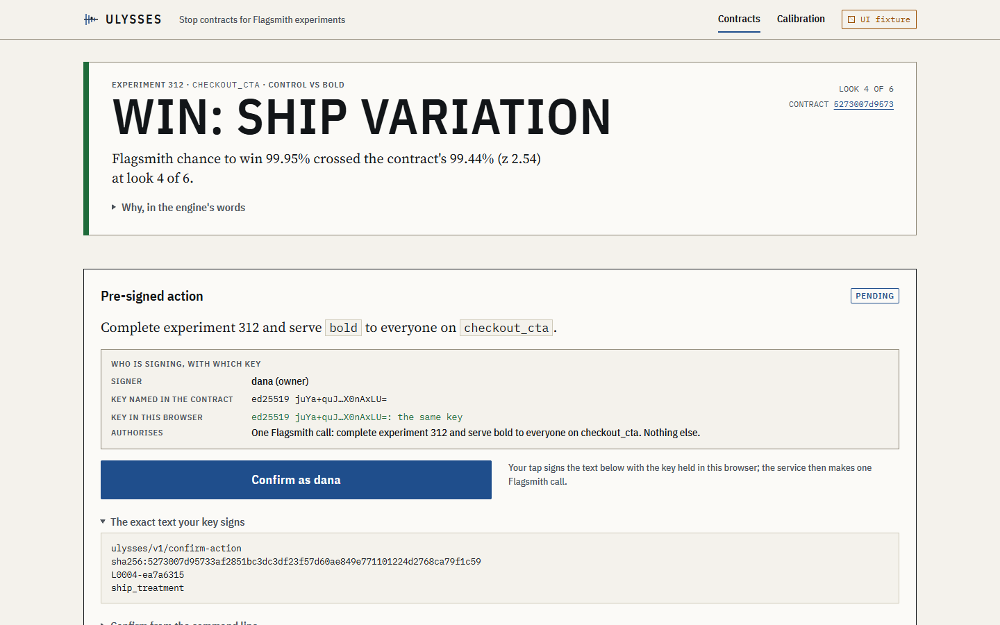

# When is a Flagsmith winner really a winner?

Ulysses lets the owner of a Flagsmith experiment sign the stop rule before any data exists. An agent then watches the experiment and can complete it and ship the winner only when that signed rule fires, not at the first look where Flagsmith's chance to win passes 95%.

Flagsmith's chance to beat control is a fair summary of the evidence each time you read it. The trouble starts when "over 95%" becomes the moment to ship and someone, or an agent, checks every five minutes. Ulysses keeps Flagsmith's number exactly as it is and adds the rule that makes acting on it safe.

How often a variation that does nothing gets shipped, measured on Flagsmith's own `stats.py` (offline simulation, synthetic units, [pending: N] A/A experiments, 30 looks of 100 per arm):

<!-- headline-table:start -->
| Rule | Error level it is meant to have | Ships a do-nothing variation |
|---|---|---|
| Stop at the first look over 95% | 10% two-sided, read 30 times | [pending: `uv run ulysses calibrate offline`] |
| Read once at the end, ship if over 95% | 10% two-sided | [pending] |
| Ulysses contract, alpha 0.10 (same level as the 95% rule) | 10% two-sided | [pending] |
| Ulysses contract, alpha 0.05 (the default) | 5% two-sided | [pending] |

Counting false losers as well (a false Losing call keeps control, so it ships nothing), any-direction false calls were: first look over 95% or under 5% [pending]; contract at alpha 0.10 [pending]; contract at alpha 0.05 [pending]. Full tables are under [Impact](#impact).
<!-- headline-table:end -->



What makes this different from an agent that asks "may I ship?": the approval that matters comes before the experiment starts, when nobody has a result to be excited about. The owner signs the horizon, the number of looks, the boundary at each look and the action for each outcome. Later, when the contract fires, the owner confirms with one tap, and that tap can only confirm the action already signed. The agent holds one token. It has no Flagsmith key and no signing key, so it cannot start an unsigned experiment, ship early, or ship the other arm.

## Try it: one command

You need Docker and [uv](https://docs.astral.sh/uv/). Nothing else, no Flagsmith account.

macOS or Linux:

```sh
git clone https://github.com/Dakshhhhh-ops/ulysses && cd ulysses && uv run python scripts/judge_demo.py
```

Windows PowerShell:

```powershell
git clone https://github.com/Dakshhhhh-ops/ulysses; cd ulysses; uv run python scripts/judge_demo.py
```

What that command does, in order:

1. Starts a stock open-source Flagsmith 2.295.2, pinned by digest, with `EXPERIMENTATION_ENABLED=true` (`docker-compose.yml`, compose project `ulysses`, dashboard on http://localhost:8280). No Flagsmith code is changed.
2. Signs up the first user on that fresh instance, creates an organisation and an organisation admin API key, and writes them to `.run/judge.env` (git-ignored) with a new agent token and webhook secret.
3. Creates the demo flags, a purchase metric and a refund-request guardrail, and the signed audit-log webhook (`ulysses lab setup`). Then two experiments: an A/A experiment on `ulysses_headline_aa`, whose two variations show the same headline, and a real-effect experiment on `ulysses_checkout_cta` (classic against bold). It also creates two signers, owner `maya` and second signer `sam`, with passphrase-encrypted key files in your user profile, outside the project folder.
4. Starts the contract service (the only process with the Flagsmith key), the demo shop and its simulated visitors, a stand-in for the owner's browser taps (a separate process holding maya's key), and the scripted agent, which gets only the Ulysses agent token.
5. Prints every look for both experiments, with each guardrail's reading, and at the end a summary of what shipped, how many looks it took and how many five-minute checks nobody had to make.

Flagsmith refreshes results at most every five minutes, so a run takes a while: [pending: minutes measured by `scripts/judge_demo.py` from a clean clone]. Afterwards, `uv run python scripts/judge_demo.py --serve-only` serves the decision cards again, and `docker compose -p ulysses down -v` removes Flagsmith and its data.

Port already taken? `--flagsmith-port`, `--port` (contract service, default 8240) and `--shop-port` (default 8241) move them. If you already run a Flagsmith with Experimentation on, `--flagsmith http://your-host:port` uses it instead of starting one (the bootstrap step creates a first user, so point it only at a throwaway instance).

To sign and confirm yourself instead of the stand-in, run the pieces by hand (next section) and open the links the agent prints.

## Set it up against your own Flagsmith

Self-hosted Flagsmith needs `EXPERIMENTATION_ENABLED=true`, and `SSRF_ALLOWED_HOSTS=host.docker.internal` if Flagsmith runs in Docker and the contract service runs on the host (Flagsmith refuses webhooks to private addresses otherwise). Tested on self-hosted 2.295.2 only. Flagsmith Cloud is untested, and its webhook would need a public URL for the service.

```sh
uv run ulysses init --flagsmith-url http://localhost:8000
```

`init` writes `.env` with a fresh agent token and webhook secret, a contract template, and `ulysses.mcp.json` for your MCP client. Both `.env` and `ulysses.mcp.json` are added to `.gitignore`, because both hold the agent token. Put an organisation admin API key and the organisation id in `.env`: in the Flagsmith dashboard, Organisation settings, API Keys, create a key with admin rights; the organisation id is the number in that page's URL.

```sh
uv run ulysses lab setup                       # demo flags, metrics, signed audit webhook (--no-webhook to skip)
uv run python scripts/demo_setup.py            # the A/A and real-effect experiments, signers maya and sam
uv run ulysses serve                           # contract service on http://127.0.0.1:8200
uv run python scripts/agent_session.py --with-traffic      # second terminal: the scripted agent
```

`demo_setup.py` lists every experiment it will clear on the two demo flags before it touches any of them. It deletes an experiment that has not started, refuses to end a running one unless you pass `--replace`, and never ends one a Ulysses contract governs.

The agent session prints a signing link and waits. Open it in a browser and sign (the first visit on a new browser uses an enrolment link from `uv run ulysses signer enrol maya`), or run the stand-in in a third terminal: `uv run python scripts/human_stand_in.py --owner maya`. If the session stops, `--resume <hash>,<hash>` continues the same contracts, and `uv run ulysses watch <hash>` looks on schedule from the command line. Both retry 429, 502, 503 and timeouts with backoff and say so in one line.

Tests need nothing running: `uv run pytest -q`. The integration test against a live Flagsmith:

```sh
ULYSSES_LIVE=1 uv run pytest tests/test_live_flagsmith.py -q          # macOS / Linux
```

```powershell
$env:ULYSSES_LIVE=1; uv run pytest tests/test_live_flagsmith.py -q   # Windows PowerShell
```

The package's distribution name is `flagsmith-ulysses` (`ulysses` is taken on PyPI). It is not on PyPI; install from the repository: `uvx --from git+https://github.com/Dakshhhhh-ops/ulysses ulysses init`.

## How it works


1. `sign_contract` reads the experiment from Flagsmith, sizes the horizon from the baseline rate and the smallest lift the owner cares about, drafts the contract and returns a signing link. The contract is TOML; its id is the SHA-256 of its canonical JSON form, so reformatting does not change it and any edited value does.
2. The owner reads the contract and signs it. In the browser the key is created by WebCrypto as non-extractable; the `ulysses sign` command uses an encrypted key file instead. The service checks the Ed25519 signature against the key it registered for that signer.
3. `start_under_contract` is refused until the signature verifies. Then the service writes the contract hash into the experiment's hypothesis in Flagsmith and starts the experiment.
4. `look` asks Flagsmith to refresh the results (respecting the five-minute floor), reads Flagsmith's chance to win, turns it back into Flagsmith's own `lift / SE`, and compares that with the signed boundary for this look. Each guardrail gets the same treatment against its own one-sided signed rule. By default a win cannot fire while a guardrail has no Flagsmith result yet (Flagsmith needs 5 conversions per arm before it reports one).
5. When a look fires, the service creates a proposal holding exactly the action the contract assigns to that outcome. `execute` is refused until the owner confirms with a signed tap, and refused outright for any other action. Then the service calls Flagsmith's `complete` with `rollout_decision`, which ends the experiment and serves the winner (or control) to everyone on the same flag.
6. Changing a signed contract (ship early, extend the horizon, swap the metric) is an amendment. It needs the owner and the second signer and is appended to the experiment's hypothesis. Lifecycle changes the service did not make, seen through the audit-log webhook or at the next look, are recorded as deviations and written on the experiment.

The statistics, and what the contract does and does not guarantee, are in [docs/STATISTICS.md](docs/STATISTICS.md).

## Use of Flagsmith

Flagsmith does the assignment, the measurement, the inference and the rollout. Ulysses computes no result of its own: the number on every card is Flagsmith's chance to win from `GET /experiments/<id>/results/`, and the only arithmetic Ulysses adds is the boundary it is compared with.

| Flagsmith feature | Where Ulysses uses it |
|---|---|
| Experiments REST API: `start`, `results/refresh`, `complete` with `rollout_decision` | The lifecycle calls, made only by the contract service, only under a signed contract. |
| Results endpoint, `chance_to_win` and lift per metric | The input to every look, for the primary metric and each guardrail. |
| Guardrail metrics (`not_increase` / `not_decrease`) | Each look reads Flagsmith's chance that the guardrail got worse; a breach of the signed rule stops and keeps control. |
| Experiment `hypothesis` field | Carries the governing contract hash, amendments, deviations and the executed outcome, so they show inside Flagsmith's own UI. |
| Organisation audit-log webhook with `X-Flagsmith-Signature` | Deviation detection and `ulysses audit replay`. The service refuses unsigned deliveries. |
| Exposures timeseries | The horizon helper's exposure rate. |
| Official Python SDK (`get_experiment_flag`, `track_event`, local evaluation) | The demo shop and the live calibration traffic. |
| `api/experimentation/stats.py` | The offline calibration loads Flagsmith's file unmodified, pinned by SHA-256. |
| Self-hosting with Docker | The one-command demo runs a stock, pinned image. |

The official Flagsmith MCP server is deliberately not wired to the agent; the reasons are under [Limitations](#limitations). The Ulysses `read_experiment` tool covers the agent's reads through the contract service.

## Impact

The cost Ulysses removes is a shipped variation that does nothing, or does harm, because someone acted on an early 95%. The tables below measure how often that happens on Flagsmith's own engine, and how often under a contract. Every figure comes from a script in this repository, and each table says what produced it.

### Offline: Flagsmith's stats.py on simulated A/A experiments

Produced by `uv run ulysses calibrate offline` (writes `.run/calibration/offline.md`). Simulated synthetic units, not user traffic.

<!-- offline-table:start -->
[pending: paste the tables from `uv run ulysses calibrate offline`: false ships first, then any false call, then the real-lift table and the identities saved against a fixed horizon]
<!-- offline-table:end -->

### Live: A/A experiments on self-hosted Flagsmith

Produced by `uv run ulysses calibrate live` and recomputed from its trace by `uv run ulysses calibrate summarise <trace>`. Every number is read from Flagsmith's results endpoint. The identities are synthetic, assigned by Flagsmith's engine through the Python SDK; they are not user traffic.

<!-- live-table:start -->
[pending: tables from `uv run ulysses calibrate summarise .run/calibration/live-<batch>.jsonl`, with the batch size, looks and per-arm counts]
<!-- live-table:end -->

### Time saved

Against a fixed-horizon test with the same false-ship level and the same power, the contract at alpha 0.05 used [pending: percentage from `uv run ulysses calibrate offline`, "Mean identities per arm used"] fewer identities on a real +25% lift (offline simulation). The first-95% rule stops earlier still, and that early stop is exactly where its false winners come from.

In the demo run, the agent ran [pending: refreshes, from `.run/agent-session-result.json`] results refreshes on schedule and reached a decision on the real-effect experiment after [pending: counted looks] counted looks, in [pending: minutes]. A person checking the results page every five minutes over that time would have refreshed it [pending: manual checks] times.

### The demo run

[pending: the looks of both experiments from a run of `scripts/judge_demo.py`: identities per arm, Flagsmith's chance to win, what the contract needed, the guardrail reading and the card, labelled synthetic visitors]

The real-effect experiment uses simulated visitors who buy 10% of the time after classic and 17% after bold, a 70% relative lift, while its horizon is sized for 50%. If it holds at a look where Flagsmith shows over 95%, that hold is the cost of the guarantee, and the table says so. The A/A experiment is where holding is plainly right: both arms show the same page, so any winner Flagsmith reports there is noise.

## Creativity

Most agent integrations put a human approval after the agent proposes an action, at the moment the human is looking at a promising number. Ulysses moves the real approval to before any data exists and turns the later one into a one-tap confirmation of something already decided. The contract is a hashed, signed file, and its hash lives on the experiment in Flagsmith, so anyone who opens the experiment can see which rule governs it. The calibration harness runs Flagsmith's own `stats.py`, unmodified and pinned by hash, so the claim about peeking is tested on the engine Flagsmith users actually get.

## Demo

The demo video shows both experiments side by side. On the A/A experiment, Flagsmith's chance to win wanders and the card holds, then reaches the horizon and keeps control. On the real-effect experiment the contract fires, the agent's early and wrong-action `execute` calls are refused on screen, the owner taps confirm, and Flagsmith serves bold to everyone. Every card shows the guardrail reading. Any judge can reproduce the same run with the one command above.




## Track 02 checklist

| Requirement | How Ulysses meets it |
|---|---|
| Uses the Flagsmith CLI, API or MCP server | The REST API for the lifecycle and results, the official SDK in the demo shop, Flagsmith's own `stats.py` in the calibration. Ulysses ships its own MCP server (four action tools and one read tool) for agents. |
| Saves real time | Looks run on schedule, so nobody refreshes the results page; the pre-signed action runs on one tap. Against a fixed horizon with the same guarantee, [pending] fewer identities in simulation. Honest cost: the contract waits longer than the first-95% rule would. |
| A human approves changes | Twice: the owner signs before start (start is refused without it) and confirms the fired action with a signed tap. Amendments need a second signer. |
| Clear output | One card per look: Flagsmith's chance to win, what the contract needs at this look, each guardrail's reading against its rule, hold or fire, and the pre-signed action. |
| A working demo | `uv run python scripts/judge_demo.py` on a machine with Docker and uv. |

## Commands

```
ulysses init                       .env, contract template, MCP client config
ulysses serve                      contract service (port from ULYSSES_PUBLIC_URL, default 8200)
ulysses mcp                        the MCP extension over stdio
ulysses keys new <name>            create an encrypted signing key file
ulysses signer enrol <name>        one-time link that creates a key in the signer's browser
ulysses contract verify <file>     validate a contract and print its hash and boundary
ulysses sign <hash> --as <name>    sign with your key file
ulysses look <hash> / watch <hash> one look / look on schedule until it fires
ulysses confirm <look id> --as <name>
ulysses amend <hash> --reason ... [--action-now ship_treatment]
ulysses horizon --min-lift 0.1 --baseline-rate 0.05 [--rate-per-hour 120]
ulysses boundary --looks 12
ulysses audit replay --project <id>
ulysses calibrate offline | live | summarise
ulysses lab setup [--no-webhook]
```

Errors print one line and a next step. `ULYSSES_DEBUG=1` shows the traceback.

## Limitations

- Ulysses binds the agent, not a dashboard admin. Someone with dashboard rights can still complete an experiment or edit its flag; Flagsmith does not lock the flag while an experiment runs. Ulysses records that as a deviation (from the audit-log webhook, or at the next look when it compares the experiment with what it started) and writes it on the experiment, retrying the write if Flagsmith is down. It cannot prevent it.
- The boundary between agent and human is a process and key boundary. In the one-command demo the agent process gets only its token, and the signer keys sit encrypted in your user profile, but everything runs as one OS user on one machine. For real use, run the contract service, its `.env` and the signer keys where the agent cannot read them: another OS user, a container or another host. An agent that can read `.env` can call Flagsmith directly.
- The official Flagsmith MCP server is not given to the agent. On open-source Flagsmith there is no read-only key: every key that can read experiments can also write flags, so handing the agent that server would hand it a way around the contract. Its `update_experiment` tool also fails on 2.295.2 (it sends `PUT`, which the endpoint rejects with or without `feature`), so Ulysses writes the hypothesis with `PATCH`. Both are written up in `upstream/`. `ulysses init --with-flagsmith-mcp` adds the server for people who accept the trade, and warns.
- Offline numbers are simulations on synthetic units. Live numbers come from Flagsmith's results endpoint, but the identities are synthetic and their behaviour is drawn by scripts in this repository. Neither is user traffic, and every table says which it is.
- The audit-log list API returns nothing on an unlicensed self-hosted instance, so the replay works from the entries Flagsmith's webhook delivered. Entries from before the webhook was registered are not covered.
- The guarantee is asymptotic and covers one treatment against control on one primary metric. At low base rates and short horizons false Losing runs over its nominal share; the contract warns the signer when the design is in that range. Details in docs/STATISTICS.md.
- Flagsmith's SDK can store an event batch twice after a timeout. That cannot change exposures or Occurrence metrics, which the demo and calibration use, but it can inflate Count, Sum and Mean metrics.

## Related work

GrowthBook offers sequential testing as an engine feature (confidence sequences, paid plans). `harshit3355/rollouts-plugin-metric-sequential` applies an anytime-valid test to Argo Rollouts canaries. Neither works with Flagsmith or binds an agent to a pre-signed rule. Evan Miller's "How Not To Run an A/B Test" is the classic account of the peeking problem.

## Upstream

[upstream/flagsmith-docs-peeking.md](upstream/flagsmith-docs-peeking.md) holds two drafted issues for Flagsmith, not posted: suggested wording for the statistics glossary's note on peeking, and the MCP `update_experiment` PUT problem.

## License

MIT
