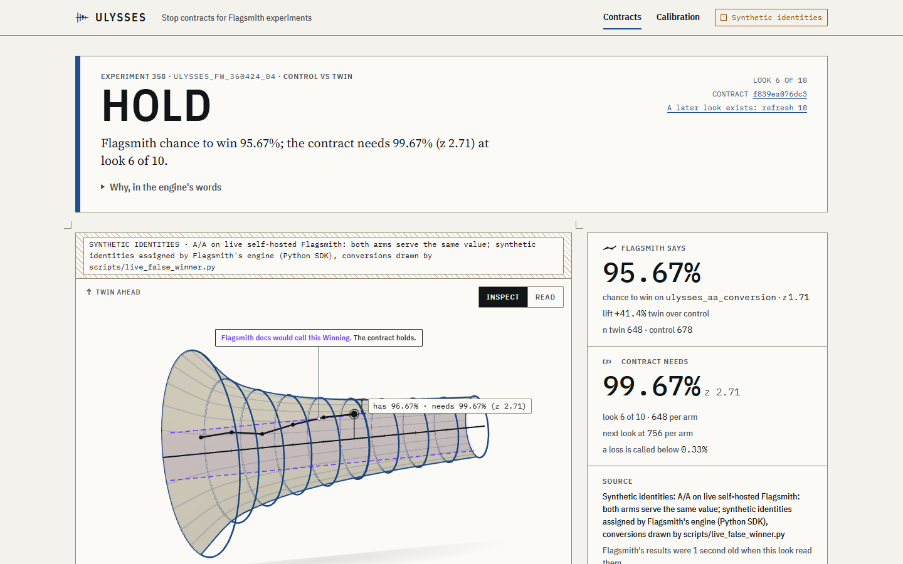

# What the contract guarantees, and what it does not

Every figure here was printed by `uv run ulysses calibrate offline` (Flagsmith's own `stats.py`, pinned by SHA-256, on simulated synthetic units), by `uv run ulysses horizon` / `uv run ulysses boundary`, by `uv run python scripts/stats_depth.py --flagsmith-src <Flagsmith checkout> --runs 2000` (the Monte Carlo checks, several treatments, the sample-ratio check and the power curves; fixed seeds, writes `.run/stats-depth.md`), or by `tests/test_look_integrity.py` (look timing, the alpha ledger, amendments and overruns; the command is given with each figure). None of it is user traffic.

## The number Ulysses thresholds

Flagsmith's engine (`api/experimentation/stats.py`, `compare_to_control`) computes, for each treatment and metric:

```
lift           = (mean_t - mean_c) / mean_c
SE             = sqrt(var_t / (n_t mean_c^2) + mean_t^2 var_c / (n_c mean_c^4))   # delta method
chance_to_win  = Phi(lift / SE)                    # 1 - Phi(...) for lower-is-better metrics
```

Flagsmith's statistics glossary calls a variation Winning above 95% and Losing below 5%, and says it is safe to check whenever you like. The API has no verdict field, and the dashboard's "Winning variation" card names the leading variant as soon as inference exists (`frontend/web/components/experiments/results/derive.ts`). The calibration therefore scores the glossary's rule: stop the first time the chance is over 95% or under 5%. That is a two-sided rule at the 10% level.

Ulysses inverts the number, `z = Phi^-1(chance_to_win)`, which gives back Flagsmith's own `lift / SE` (undoing the flip for lower-is-better metrics). It adds no estimator of its own. The only statistics in Ulysses are the stopping boundaries and the horizon calculation.

## The boundary

Before the experiment starts, the contract fixes a horizon N (identities in the smaller arm), a maximum number of looks K at N/K, 2N/K, ..., N, and a two-sided level alpha (default 0.05). The boundary comes from the Lan-DeMets alpha-spending function of O'Brien-Fleming type, applied to each side at alpha/2:

```
a(t) = 2 - 2 Phi( z_{1 - alpha/4} / sqrt(t) )      per side, t = information fraction
```

At each look the boundary b_k solves P(first crossing at look k | no effect) = spent(t_k) - spent(t_{k-1}), using the canonical joint distribution of sequential Wald statistics (independent increments on the score scale), computed by numerical integration. A look that lands late gets the boundary for the fraction it actually has; only the look at the horizon spends what is left. Win if z >= b_k, loss if z <= -b_k, no decision if the horizon arrives first.

The integration runs forward through the boundaries the earlier looks actually applied, read from the alpha ledger (below), not through boundaries re-derived from the contract as it stands now. Without an amendment the two are the same numbers; after one they are not.

Checks in `tests/test_boundary.py`:

- Classical O'Brien-Fleming constants C_B(K, 0.05) match Jennison and Turnbull (2000), Table 2.3: 1.977, 2.004, 2.024, 2.040, 2.087, 2.126 for K = 2, 3, 4, 5, 10, 20.
- Lan-DeMets boundaries for K = 5 equally spaced looks match gsDesign `sfLDOF` and ldbounds: 4.8769, 3.3569, 2.6803, 2.2898, 2.0310.
- The total null crossing probability for 30 looks is 0.025 per side to 1e-6, and a 200,000-run Monte Carlo of the joint distribution agrees with the integration.

`tests/test_monte_carlo.py` checks every boundary family a contract can sign against Monte Carlo of that joint distribution with fixed seeds (20 cases, 14.9 seconds in one run of `uv run pytest -q tests/test_monte_carlo.py`): two-sided boundaries at 2, 5, 12 and 30 looks, alpha 0.05 and 0.10, one comparison of a three-treatment contract (alpha 0.05/3), looks landing off schedule, the rounded z values written into a contract table, power and expected stop fraction at three drifts, one-sided guardrail boundaries (alpha 0.01, 0.01/3 and 0.05), the non-binding lower boundary, the Bonferroni split with a shared control, the engine itself (`decision.evaluate`) on 3,000 null paths of three treatments sharing a control, which must give the same outcome, winner and stopping look as the simulation's rule on every path and ship at most alpha/2 plus four standard errors, and the sample-ratio test. Each must agree within four standard errors plus 5e-4. From `scripts/stats_depth.py`, no effect, 200,000 paths per row:

| Boundary | Looks | Level | Upper, integration | Upper, Monte Carlo | Lower, Monte Carlo |
|---|---|---|---|---|---|
| Lan-DeMets O'Brien-Fleming, two-sided | 5 | 0.05 | 2.500% | 2.486% | 2.492% |
| Lan-DeMets O'Brien-Fleming, two-sided | 30 | 0.05 | 2.500% | 2.467% | 2.521% |
| Lan-DeMets O'Brien-Fleming, two-sided | 12 | 0.10 | 5.000% | 4.950% | 5.064% |
| One comparison of three (alpha/3) | 10 | 0.01667 | 0.833% | 0.816% | 0.829% |
| Pocock-type guardrail, one-sided | 6 | 0.01 | 1.000% | 1.011% | n/a |
| Pocock-type guardrail, one-sided | 30 | 0.01 | 1.000% | 0.984% | n/a |

## What the calibration measured

Pooled over five seeds, 10,000 simulated A/A experiments, 30 looks of 100 synthetic identities per arm, 10% conversion in both arms (`.run/calibration/offline.md`, 95% Wilson intervals):

| Rule | Level | Ships a do-nothing variation (false Winning) | Any false call |
|---|---|---|---|
| Read once at the final look (95%/5%) | 10% two-sided | 3.9% (3.5-4.3) | 9.8% (9.3-10.4) |
| Stop at the first look over 95% or under 5% | 10% two-sided, read 30 times | 13.4% (12.7-14.1) | 44.7% (43.7-45.6) |
| Ulysses contract, alpha 0.10 | 10% two-sided | 3.0% (2.7-3.4) | 10.1% (9.5-10.7) |
| Ulysses contract, alpha 0.05 (default) | 5% two-sided | 1.3% (1.1-1.6) | 5.3% (4.9-5.8) |

Compare like with like. The 95%/5% thresholds are a 10%-level rule, so the fair comparison is the contract at alpha 0.10: reading the 95% rule at every one of 30 looks raises false ships from 3.9% to 13.4%; the contract at the same level keeps them at 3.0%. The default contract is stricter still (alpha 0.05).

The same run also writes `.run/calibration/paths-offline.json`: Flagsmith's chance to win at every look for runs 1 to 100 of seed 62944 (the opening runs of the pooled table, the same random draws), with the look where each rule stops. In those 100 runs the first-95% rule ships 12 do-nothing variations (and stops 30 more under 5%), the contract at alpha 0.10 ships 3 (5 false losses) and at alpha 0.05 ships 3 (3 false losses). The calibration page draws them as "Two ships". `uv run ulysses calibrate offline --flagsmith-src <Flagsmith checkout> --paths-only` writes only that file in seconds; the committed copy `data/paths-offline.json` was written by that command, and the page falls back to it when the run directory holds an `offline.json` of the same design and engine but no export of its own.

With a true relative lift of +25% (10% to 12.5%), 10,000 runs: the first-95% rule calls the win in 91.0% of runs (and calls it the wrong way in 5.0%); the contract calls it in 88.4% at alpha 0.10 and 79.3% at alpha 0.05, never the wrong way, at mean look 19.9 and 21.8 of 30. Against a fixed-horizon test with the same false-ship level and the same 79.3% power, which needs 2,858 identities per arm, the default contract used 2,350.2 on average: 17.8% fewer.

## What it guarantees

If the z values Ulysses reads behave like the sequential Wald statistics they are (asymptotically normal, independent increments, information proportional to identities), and the times of the analyses do not depend on the z values, then across all looks the chance of declaring a winner when there is no effect is at most alpha/2.

The second condition is the one an agent could break, and the service now enforces it rather than assuming it.

## When a read is a look

An agent that can see z between looks, and decides when to call `look`, chooses its own analysis times from the data: it waits, reads, and looks only when z is above the boundary it would get right then. Earlier versions allowed this. `read_experiment` returned Flagsmith's chance to win at any time without counting anything, the between-looks ("watch") reply carried it too, and a look counted only when the agent called `look`. So the earlier claim here, that the guarantee held however often the agent looked, was wrong.

Measured through the service itself (contract, store, fake Flagsmith; only the z paths come from numpy): Flagsmith's results refresh at 25 evenly spaced counts up to the horizon; from the first planned count on (21 refreshes), an agent polls `read_experiment` at each and calls `look` only when the z it saw is at or above the boundary it would get by looking then. Contract alpha 0.05, 5 looks, no effect, seed 20311, 4,000 paths (`ULYSSES_PEEK_RUNS=4000 uv run pytest -q -s tests/test_look_integrity.py -k peeking`; the "before" row is the same test run against the code before this change):

| | Ships a do-nothing variation | Same paths, an agent looking at the planned counts | Paths where the two differ |
|---|---|---|---|
| Before | 142/4000 = 3.55% | 102/4000 = 2.55% | 40 |
| Now | 102/4000 = 2.55% | 102/4000 = 2.55% | 0 |

What the service does now, on an experiment a contract governs:

- **The first read at the planned count is the look, whoever makes it.** Every path that reads Flagsmith's results for a governed experiment goes through the same step: `look` (from MCP, the CLI's `ulysses look` or HTTP), `read_experiment` (MCP or HTTP), and the service's own poller. When the smaller arm has reached the next planned count, that read is recorded as the counted look (and may fire). Whether a read counts depends on identities alone, never on z. A later call at the same count is between looks.
- **Between looks the numbers are withheld.** Until the contract decides, `read_experiment` returns identities per arm, the sample-ratio p-value and `next_look_at_identities`, with `chance_to_win` and `lift` set to null and `redacted: true`; the watch reply, its card and the experiment's look list carry no chance to win, z, lift, guardrail number or per-arm number either. A counted look shows everything, since its alpha is spent. Once the contract has decided, or the experiment is completed, `read_experiment` shows Flagsmith's numbers again.
- **The service can keep the schedule itself.** `ulysses serve --poll [SECONDS]` takes a look on every active contract every SECONDS (default 60), subject to each contract's refresh floor, so looks need not wait for an agent at all.

With this, the same strategic agent ends with exactly the outcome of an agent that looks at the planned counts on every one of the paths above; `tests/test_look_integrity.py::test_strategic_peeking_agent_cannot_raise_false_wins` checks it on 250 paths in the regular suite.

What this does not cover. The agent still decides when to ask Flagsmith for a refresh. Between looks it decides blind to the current z. It does see z at each counted look, and could delay the next refresh because of it, so the next look lands later; spacing chosen from earlier results is outside the alpha-spending guarantee (it is not measured here). `ulysses serve --poll` takes that choice away from the agent. A read that reaches the planned count while Flagsmith shows no result for the primary metric yet ("collecting data") is not counted; the next read that has one is. Anyone who sees Flagsmith's own numbers another way (the Flagsmith dashboard, or an agent also given Flagsmith's MCP server with an admin key, which `ulysses init --with-flagsmith-mcp` can configure) can still time requests on them; the service cannot withhold what Flagsmith itself shows.

## The alpha ledger

Each counted look stores, in its recorded decision (`decision.ledger`), the boundary it applied at full precision (`boundary_applied`, per comparison), the fraction it was analysed at (`fraction_landed`), and the alpha spent once it is analysed (`alpha_spent`, both sides, all comparisons; `comparison_alpha_spent` per comparison), against the signed alpha (`alpha_signed`). Each guardrail row stores its own `boundary_applied`. The look card carries `alpha.spent`, `alpha.signed` and the line "Alpha spent so far: x of the signed y"; between looks the watch reply carries the alpha spent so far.

Every new boundary integrates forward from the ledger's applied boundaries and spends only what is left: the spending function's value at this fraction less what the earlier looks spent, or everything left at the horizon. If the earlier looks have already spent more than the spending function allows at this fraction (a horizon amended upwards), no stop is possible at this look. `ulysses verify` rebuilds the same ledger from the bundle's own numbers and does not trust the stored one.

Two service processes on one database cannot count the same planned look twice: the counted looks a decision rests on are read again and the look inserted inside one write transaction (SQLite WAL mode with a busy timeout), and a look's sequence number is unique per experiment. A database written before that constraint, holding a repeated sequence number, still opens, with a non-unique index; its numbers are not rewritten, because the owner's confirmation signs a hash chain over them.

## Amendments and the horizon

An amendment may not move the horizon to, or below, the largest count at which a look was already counted. The service refuses it when it is drafted (`400 Invalid`: "the horizon cannot be amended to N identities per arm: the contract already counted a look at M identities per arm ...", which the CLI prints with the hint to amend to more than M), and again when the second signature arrives if a look was counted in between (`409`). Earlier, such an amendment froze the contract for good: the counted look sat at or past the new horizon, so no later read could be scheduled. The engine no longer depends on the rule for that; a contract amended that way before the rule existed treats its next read past the last counted look as the final one.

An amendment that raises the horizon changes the fractions of the looks still to come, not the alpha already spent. Before the ledger, the engine re-derived the whole spending history from the new horizon, as if it had always applied. Contract alpha 0.05, 5 looks at a horizon of 1,000 per arm, counted looks at 200, 400 and 600, then the horizon doubled to 2,000 and looks at 800, 1,200, 1,600 and 2,000, by integration of the boundaries the service applied (`uv run pytest -q -s tests/test_look_integrity.py -k amended_horizon`):

| | Chance of a false win | Chance of a false loss |
|---|---|---|
| Before (re-derived history) | 2.718% | 2.718% |
| Now (ledger) | 2.500% | 2.500% |

## Looks that land late, and a final read past the horizon

A final read that lands past the horizon was analysed as if it had landed on it: the earlier looks kept their fractions of the horizon, so the final look was treated as adding less information than it did. It is now analysed on the fractions as they landed (each earlier look's count divided by this read's count, the final look at 1), spending exactly the alpha that is left after the boundaries already applied. Contract alpha 0.05, 5 looks at a horizon of 1,000 per arm, looks at 200, 400, 600 and 800, then the final read at 1.5 or 10 times the horizon, by integration (`uv run pytest -q -s tests/test_look_integrity.py -k past_the_horizon`):

| Final read at | False win before | False win now | False loss now |
|---|---|---|---|
| 1.5 x horizon | 2.830% | 2.500% | 2.500% |
| 10 x horizon | 3.224% | 2.500% | 2.500% |

The shipped replay trace (`data/replay-judge-demo.jsonl`) has one such final read, at 1,123 identities per arm against a horizon of 1,088, recorded under the earlier rule: its boundary was z 2.0358 and is now z 2.0457, and the outcome (no decision) is the same. The replay labels that one difference instead of hiding it.

The measured false-win rate stayed at or below alpha/2 in every design tested, including the low-count ones below.

## Where it fails, and by how much

The guarantee is asymptotic and Flagsmith's z is on relative lift. At small counts that z is skewed: a treatment that happens to fall behind gets a smaller SE, so large negative z values come more often than large positive ones. The costly error (shipping a variation that does nothing) stays under alpha/2; the cheap one (keeping control after a false loss) runs over its nominal alpha/2. Contract at alpha 0.05, A/A, 2,000 runs per row:

| Base rate | Identities per arm per look x looks | Expected conversions per arm at the horizon | False Winning (nominal 2.5%) | False Losing (nominal 2.5%) |
|---|---|---|---|---|
| 2% | 100 x 30 | 60 | 0.1% (0.1-0.4) | 5.6% (4.7-6.7) |
| 5% | 100 x 30 | 150 | 0.8% (0.5-1.3) | 5.9% (4.9-7.0) |
| 10% | 100 x 30 | 300 | 1.6% (1.1-2.2) | 4.0% (3.2-5.0) |
| 2%, horizon from `ulysses horizon` for a 25% lift | 605 x 30 | 363 | 1.2% (0.8-1.8) | 3.6% (2.9-4.6) |

So "at most alpha in total" is not what the contract gives at these counts: the total false-call rate measured 5.3% at the 10% base rate and up to about 6.7% at 2% and 5% with a small horizon, almost all of it false losses. The service turns this into policy: a contract whose design gives fewer than 100 expected conversions per arm at the horizon is refused unless the signers record an override reason, and below 400 the signing page carries a warning. A horizon smaller than the one `ulysses horizon` gives for the stated baseline and lift is also refused without an override.

## Guardrails

Guardrails used to stop on a fixed rule: 97.5% chance the metric moved the wrong way, at any refresh. That is the peeking problem again. In A/A (a 10% guardrail metric with no effect in either arm, same design as above) it stopped 6.0% of experiments for a not-increase guardrail and 22.0% for a not-decrease guardrail; the asymmetry is the same delta-method skew.

The contract now gives each guardrail its own one-sided budget, spent with a Lan-DeMets Pocock-type function, alpha * ln(1 + (e - 1) t), and judged only at the counted looks, on z = Phi^-1(Flagsmith's chance the metric got worse). Pocock-type spending keeps early stops possible, which a safety rule needs. Between looks the guardrail's number is shown and nothing stops. The default budget is 0.01, chosen from measurement:

| Guardrail budget | not increase: false stops in A/A | not decrease: false stops in A/A | Runs |
|---|---|---|---|
| 0.05 | 1.6% (1.4-1.9) | 10.7% (10.1-11.4) | 10,000 |
| 0.025 | 0.4% (0.2-0.6) | 7.3% (6.5-8.1) | 4,000 |
| 0.01 (default) | 0.1% (0.1-0.2) | 4.4% (4.0-4.8) | 10,000 |

A guardrail stop only ever keeps control, so it cannot raise the false-ship rate; it costs power on experiments that were fine. By default a win also does not ship while Flagsmith has no result for a guardrail ("collecting data": fewer than 5 conversions per arm for an occurrence metric); at the horizon that becomes "no decision, keep control". A contract can turn this off with `require_guardrail_results_to_ship = false`, and the signing page shows the setting.

## What else it does not cover

- Flagsmith calls chance_to_win a Bayesian posterior. Under a flat prior it is one, and a posterior read at a fixed time is well calibrated. Ulysses does not dispute that. It adds a frequentist property for the case the docs invite: acting the first time the number crosses 95%.
- One primary metric. Several goal metrics would need a correction the contract does not apply; a contract names one, and other goal metrics attached in Flagsmith are not read. Several treatments are covered (below).
- It does not fix bad data beyond the split. Quarantined identities and event loss are Flagsmith's to detect; the sample-ratio check below catches arms that got the wrong share of identities, not events lost in both arms alike.
- An amendment that changes the horizon after looking at the data is a data-dependent change. The ledger stops the alpha already spent from being spent again (2.500% above holds for a horizon change fixed in advance of the remaining data); the second signature and the line written on the experiment make the change visible; none of that makes choosing the new horizon from the data statistically free.
- The live calibration on a running Flagsmith is a small sample (tens of experiments) and confirms the direction of the offline result; the offline table carries the large-sample claim.

## Horizon helper

`ulysses horizon` uses the same delta-method variance as Flagsmith to turn a baseline and the smallest relative lift you care about into identities per arm, then solves for the drift at which the signed boundary is crossed with the requested power.

It asks for more identities than a difference-in-proportions calculator (Evan Miller's, Optimizely's), because Flagsmith's z is on relative lift and its control-variance term carries an extra (1 + lift)^2. For a one-look test at alpha 0.05 and 80% power:

| Baseline, smallest lift | Helper, one look | Difference-in-proportions formula | Ratio | Helper, 30-look contract |
|---|---|---|---|---|
| 5%, +10% | 34,363 | 31,231 | 1.100 | 36,067 |
| 2%, +25% | 17,268 | 13,807 | 1.251 | 18,124 |
| 10%, +25% | 3,140 | 2,504 | 1.254 | 3,296 |

The sequential design then adds a small inflation over one look, at 80% power: 1.025 for 5 looks, 1.038 for 10, 1.040 for 12 and 1.050 for 30 (`ulysses.boundary.inflation_factor`). Looks are spaced over the exposure rate read from Flagsmith's exposures timeseries.

## Several treatments against one control

Flagsmith's results payload carries one `inference` entry per non-control variant (`api/experimentation/services.py`, `_metric_inference`: every key in `variants` except `control` is compared with control by `compare_to_control`), each with its own `chance_to_win`, and `variants[key].n` per arm. The REST parser keeps each one as `<metric>@<variant>`; a contract with several treatments reads those and never the single unsuffixed copy.

A contract lists the extra arms in `experiment.more_treatments` and must then sign `boundary.multiplicity = "bonferroni"`. With m treatments each treatment-vs-control comparison gets its own Lan-DeMets O'Brien-Fleming boundary at alpha/m (two-sided), and the signed table is that per-comparison boundary. At a counted look (the smallest arm past the planned count, every treatment with a Flagsmith result):

- win if any treatment crosses its upper boundary; the one shipped is the crossing treatment with the largest z, and the look records it (`winner`), so the owner's tap and the single Flagsmith `complete` call ship exactly that variant;
- loss only if every treatment is below its lower boundary at the same look;
- each guardrail is judged per treatment at its alpha/m, and a breach in any arm keeps control;
- an amendment cannot authorise "ship treatment now" for such a contract, because it cannot say which.

The decision card names the arm it is about: the winner when there is one, otherwise the treatment with the highest chance to win, for the header, the lift line and the plate's "ahead" label, and it labels each guardrail row with its arm.

What it guarantees: the chance of shipping a treatment that does nothing is at most alpha/2 (2.5% at the default), whatever the other arms do and however their z values correlate through the shared control. Bonferroni needs no assumption about that correlation: a false ship needs some null arm to cross its own boundary, each does so with probability at most alpha/(2m), and there are at most m of them. A lower boundary does not stop a single arm, so it is non-binding for that arm; its chance of a later upper crossing is still what it is built to spend (0.8333% against 0.8333% for one comparison of three at 12 looks, by integration).

Why Bonferroni and not Holm: Holm gains power by re-spending the alpha of a rejected comparison on the others, but the contract stops and ships at the first crossing, so there is nothing left to re-spend it on; at the stopping look Holm could only declare further winners, and only one is shipped. Dunnett-type boundaries, which use the correlation, would be less conservative; they are not implemented.

What it costs, measured. No treatment does anything, contract alpha 0.05, 10 looks, canonical model with a shared control, 200,000 runs per row:

| Treatments | Ships a do-nothing treatment, Bonferroni | Without the split (0.05 per comparison) |
|---|---|---|
| 1 | 2.52% | 2.52% |
| 2 | 2.34% | 4.58% |
| 3 | 2.26% | 6.28% |
| 5 | 2.13% | 9.18% |

Without the split the false-ship rate grows with every arm. With it, it stays under 2.5%, a little below because the comparisons are positively correlated.

The same question end to end, with Flagsmith's own `stats.py` (v2.295.2, pinned by SHA-256) on simulated 0/1 conversions at 10% in every arm, 30 looks of 100 synthetic identities per arm, Flagsmith's collecting-data floors, decided by `decision.evaluate`, 2,000 A/A experiments per row, 95% Wilson intervals:

| Treatments | Contract | Ships a do-nothing treatment | Keeps control on a false loss |
|---|---|---|---|
| 1 | alpha 0.05 | 20/2000 = 1.0% (0.6-1.5) | 79/2000 = 4.0% (3.2-4.9) |
| 2 | alpha 0.05, Bonferroni | 18/2000 = 0.9% (0.6-1.4) | 4/2000 = 0.2% (0.1-0.5) |
| 2 | no split | 43/2000 = 2.1% (1.6-2.9) | 8/2000 = 0.4% (0.2-0.8) |
| 3 | alpha 0.05, Bonferroni | 12/2000 = 0.6% (0.3-1.0) | 1/2000 = 0.1% (0.0-0.3) |
| 3 | no split | 54/2000 = 2.7% (2.1-3.5) | 6/2000 = 0.3% (0.1-0.7) |

At these low counts Flagsmith's relative-lift z is skewed (see above), so every false-win rate here is below its nominal level, and false losses are rare with several arms because all of them must fall below at once. The price is power: a three-treatment contract needs a larger horizon per arm (see the last table).

## Sample-ratio check

Flagsmith computes a sample-ratio p-value (`srm_p_value`), but against the environment-default weights, which are all zero once the experiment's rollout is applied; on running experiments it was `null` (field guide). A contract therefore signs its own check: `sample_ratio.split` (percent per arm, control included), `p_threshold` (default 0.001, the level Flagsmith's own docstring calls a broken split) and `min_total` (default 100, Flagsmith's own floor). The contract itself does not validate unless the split names exactly the experiment's arms, and the service refuses a contract whose split does not match the experiment's rollout weights in Flagsmith, and drafts it from those weights. Contracts signed before the check existed carry none; the signing page says so.

At every read Ulysses runs Pearson's chi-square of Flagsmith's exposure counts (`variants[key].n`, quarantined identities already removed) against the signed split, k - 1 degrees of freedom: the same formula as Flagsmith's `srm_p_value` (a test compares the two to 1e-9 when `FLAGSMITH_SRC` points at a checkout). A p-value under the threshold holds a win, with the counts and p-value in the reason and on the card; at the horizon it becomes no decision, keep control. It never ships, never stops on its own, and never blocks a loss or a guardrail stop.

What it costs and what it catches. Two arms signed 50/50, 30 looks, 200 new synthetic identities per look assigned at random with the true share below, 10,000 simulated experiments per row, 95% Wilson intervals:

| True share of control | Any look reads a mismatch | Mismatch at the final look | First look caught (median) |
|---|---|---|---|
| 0.50 (split intact) | 1.1% (0.9-1.3) | 0.1% (0.0-0.2) | look 10 |
| 0.51 | 8.5% (8.0-9.1) | 4.6% (4.2-5.0) | look 18 |
| 0.52 | 52.5% (51.5-53.5) | 42.9% (41.9-43.9) | look 19 |
| 0.55 | 100.0% (100.0-100.0) | 100.0% (100.0-100.0) | look 6 |

Read at every look, a correct split shows a mismatch at some look in about 1% of experiments; that matters only if a win is crossed at the same look, and then it costs power, not a false ship. A split 5 points off is caught within a few looks; one 1 point off mostly is not, at these counts. The check says the arms did not get the traffic signed for. It cannot say why, and it does not make a biased comparison unbiased.

## Power and expected sample size, for the signer

The signing page draws, from the contract itself, the chance it ships the treatment, the chance it keeps control on a loss, and the expected identities per arm before it stops, for each true effect (`ulysses.power`, also served as JSON at `/human/contract/<hash>/curves`). With a recorded baseline the x axis is the relative lift, turned into an expected z with Flagsmith's delta-method variance as in `ulysses horizon`; without one it is the expected z at the horizon. For two arms the curves are computed exactly by the same integration that builds the boundary; for several treatments they are simulated (4,000 runs per point, fixed seed, one treatment with the effect and the others with none). Examples, baseline 10%, smallest lift +25%, alpha 0.05, 80% power asked of `ulysses horizon`:

| Treatments | Looks | Horizon per arm | Method | Power at +25% | Expected per arm at +25% | One read at the end, same power | Expected per arm with no effect |
|---|---|---|---|---|---|---|---|
| 1 | 12 | 3,267 | analytic | 80.0% | 2,480 | 3,141 | 3,237 |
| 1 | 30 | 3,296 | analytic | 80.0% | 2,438 | 3,141 | 3,262 |
| 3 | 12 | 4,307 | simulation | 79.1% | 3,398 | 4,111 | 4,292 |

The curves describe the stop rule under the normal approximation with looks on their planned counts. They leave out the low-count skew of Flagsmith's z measured above, event loss and looks that land late. With no effect the contract runs to near its horizon, so then it is not cheaper than a single read at the end.

A contract signed with a negative smallest lift (a metric that should go down) is planned by `ulysses horizon` and drawn by `ulysses.power` on the size of that lift, so the chart's axis then reads "True relative improvement" and the page states the signed lift next to it; the marked +25% stands for a signed -25%.

## The headline run, as the README quotes it

`uv run ulysses calibrate offline --flagsmith-src <Flagsmith checkout>`: Flagsmith `stats.py` (v2.295.2, sha256 `97c5ebfca7c8`) on 10000 simulated A/A experiments (5 seeds pooled), 30 looks of 100 synthetic identities per arm, base rate 10%, 95% Wilson intervals. The table is in [What the calibration measured](#what-the-calibration-measured). Two details the table leaves out: most of the first-look rule's false calls are false losses (31.3% of runs), which keep control and ship nothing; and with a true +25% lift the contract stops at mean look 19.93 (alpha 0.10) and 21.81 (alpha 0.05) of 30. The Two Ships picture on the README and the calibration page takes its counts from `data/paths-offline.json` and its rates from `data/offline.json`, both written by that command.

The cost is time: the contract waits longer than the first-95% rule. In the recorded judge demo the real-effect experiment first read over 95% (95.21%) 6.1 minutes in, and the contract fired at 21.5 minutes (`uv run python scripts/judge_demo.py --replay data/replay-judge-demo.jsonl`). Nobody refreshed a page in that time; looks were counted at the planned counts and the owner tapped once.

## Live runs on self-hosted Flagsmith

All live traffic is synthetic identities assigned by Flagsmith's engine through the Python SDK; every number is read from Flagsmith's results endpoint. The traces ship without timestamps and can be re-scored from a clone.

| Batch | A/A experiments | Design | First look over 95% or under 5%: false Winning / any false call | Contract: false Winning / any false call | Command |
|---|---|---|---|---|---|
| `360424` | 30 | 10 looks, horizon 1080 per arm, signed contracts in the service | 1/30 = 3.3% (1-17) / 12/30 = 40.0% (25-58) | 0/30 = 0.0% (0-11) / 2/30 = 6.7% (2-21) | `uv run ulysses calibrate summarise data/live-fw-360424.jsonl` |
| `29ab1e` | 30 | same | 0/30 = 0.0% (0-11) / 8/30 = 26.7% (14-44) | 0/30 = 0.0% (0-11) / 2/30 = 6.7% (2-21) | `uv run ulysses calibrate summarise data/live-fw-29ab1e.jsonl` |
| `72e1bc` | 30 | 6 looks, horizon 600 | 0/30 = 0.0% (0-11) / 1/30 = 3.3% (1-17) | 0/30 = 0.0% (0-11) / 1/30 = 3.3% (1-17) | `uv run ulysses calibrate summarise data/live-72e1bc.jsonl` |
| `d11c7f` | 60 | 10 looks, horizon 1000, stopped after look 8 | 4/60 = 6.7% (3-16) / 13/60 = 21.7% (13-34) | 0/60 = 0.0% (0-6) / 2/60 = 3.3% (1-11) | `uv run ulysses calibrate summarise data/live-d11c7f.jsonl` |

These batches are too small to separate the rules: the intervals overlap. What they show is the whole pipeline working on Flagsmith's own results endpoint, the contract shipping no do-nothing variation in any of the four batches, and Flagsmith's chance to win leaning toward false Losing at these counts (10 of 30 and 7 of 30 experiments read under 5% while the contract held, per `live_false_winner.py count`). Batch `d11c7f` stopped at look 8 of 10 on a Flagsmith 429, so 58 of its 60 contracts were still holding. A batch `ab1aca` lost events to an SDK buffer overflow and is not reported.

### A live false "Winning"



Experiment 358 (flag `ulysses_fw_360424_04`) on self-hosted Flagsmith, look 6 of 10. Flagsmith's chance to win was 95.67%, which its docs would call Winning; the contract signed before the start needed 99.67% at that look, so the card says HOLD. It is an A/A experiment (both arms serve the same value) with synthetic identities sent through Flagsmith's Python SDK, so holding was right. In the two signed-contract batches (`360424` and `29ab1e`, 60 A/A experiments, each under its own signed contract) Flagsmith read over 95% while the contract held in 1 of the 60: this one, at looks 5, 6 and 9. The contracts shipped 0 do-nothing variations. False "Winning" moments were rare in these batches; the 10,000-run simulation carries the claim about how often they happen.

```sh
uv run python scripts/live_false_winner.py count data/live-fw-360424.jsonl   # 1 of 30 over 95% while held
uv run python scripts/live_false_winner.py count data/live-fw-29ab1e.jsonl   # 0 of 30
```

## The agent skill's stop rule

The [`flagsmith-experiment-rollout`](../skills/flagsmith-experiment-rollout/SKILL.md) skill applies its stop rule with `scripts/stop_rule.py check`, without Ulysses. On Flagsmith's own `stats.py` and the same draws as the headline table, that rule shipped a do-nothing variation in 3.9% of 10,000 A/A runs against 13.4% for the first read over 95%, kept the same power on a +25% lift (91.0%), and shipped early in 41.1% of those runs (`uv run python scripts/skill_rule_calibration.py --flagsmith-src <Flagsmith checkout>`; `tests/test_skills.py` checks the skill's quoted numbers against `data/skill-rule-offline.json`).
